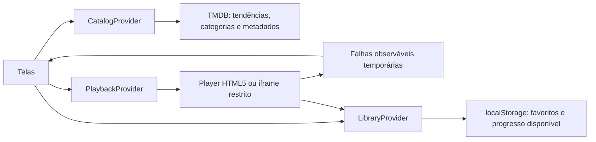

# NOCTA

Protótipo original de descoberta de filmes e séries para web e Android. React, Vite, TypeScript, Tailwind CSS, React Router e Capacitor. Sem serviços pagos, contas, anúncios ou assinaturas.

## Iniciar

Requer Node.js 20.19+ (ou 22.12+) e npm. Na pasta `C:\Users\PC\Desktop\fuzz`:

```powershell
npm install
npm run dev
```

Abra **http://127.0.0.1:5173/**. A interface pública utiliza exclusivamente o TMDB. Sem chave configurada, mostra uma orientação de configuração e nenhum título fictício ou vídeo de demonstração. Os favoritos e o histórico antigos são preservados no dispositivo; itens de demonstração ficam ocultos.

Em uma futura hospedagem estática, configure fallback das rotas para `index.html` (SPA). Não publique a pasta `inspirações/`: os arquivos distribuíveis da web estão exclusivamente em `dist/`.

```powershell
npm test           # testes de domínio, persistência, player e telas
npm run build     # verificação TypeScript e build em dist/
npm run preview   # servir o build de produção
npm run test:e2e  # testes reais desktop/móvel no Microsoft Edge instalado
```

Os testes E2E usam Edge e Chrome já instalados e viewport móvel, sem baixar navegador nem emular Android. A suíte serve em `127.0.0.1:5175`, com chave fictícia de teste. `e2e/platform.spec.ts` intercepta o TMDB e imagens com dados simulados e bloqueia os demais domínios. A suíte separada de diagnóstico de iframe utiliza uma amostra autorizada e requer internet. Para verificar somente o catálogo: `npx playwright test e2e/platform.spec.ts --project=mobile --project=desktop`. O build do E2E usa configuração de teste; execute `npm run build` novamente antes de sincronizar o Android.

## Configurar o TMDB

1. Solicite sua própria **API key v3** em uma conta TMDB.
2. Crie um arquivo `.env` na raiz, se ainda não existir.
3. Preencha `VITE_TMDB_API_KEY=sua_chave_v3` e reinicie o Vite.

O campo espera a API key v3, não o token longo de leitura. Os testes não usam sua chave. A home consulta `trending/all/day` (ou `trending/movie/day` e `trending/tv/day` nas abas), preservando a ordem do TMDB. Se tendências falharem, tenta populares. As categorias independentes usam `discover/movie` e `discover/tv`, conforme a configuração única em `src/config/catalogRails.ts`, com mapas separados de gêneros para filmes e TV. Novelas usa Soap (10766), não qualquer drama. A categoria Animes é uma aproximação por metadados, não uma classificação explícita do TMDB. Falhas parciais não derrubam os demais trilhos. Em indisponibilidade total, a listagem fica vazia com aviso.

Contratos oficiais: [tendências](https://developer.themoviedb.org/reference/trending-all), [descoberta de filmes](https://developer.themoviedb.org/reference/discover-movie) e [descoberta de séries](https://developer.themoviedb.org/reference/discover-tv).

**Variáveis `VITE_*` são incorporadas ao JavaScript público.** A chave deste protótipo de desenvolvimento não é um segredo protegido no navegador. `.env` é ignorado pelo Git, mas isso não oculta a chave no build. Não publique uma chave de produção: um produto futuro deve usar uma camada de servidor com política própria de acesso e limites. Não registrar URLs de requisição com a chave em logs.

A página **Sobre o projeto & créditos** contém o logo oficial e a atribuição exigida. O logo em `public/tmdb.svg` foi obtido sem alterações do domínio oficial. A presença de um título no TMDB **não habilita sua reprodução**.

Referências: [autenticação](https://developer.themoviedb.org/docs/authentication-application), [FAQ, uso não comercial e atribuição](https://developer.themoviedb.org/docs/faq), [logos aprovados](https://www.themoviedb.org/about/logos-attribution).

O TMDB informa que uso não comercial pode ser gratuito com atribuição e que projetos comerciais precisam de condições próprias. Este protótipo não é um produto comercial. Os filtros refinam o primeiro conjunto retornado pela busca/populares; não há paginação remota infinita nesta versão. Filtrar uma seleção não equivale a consultar todo o acervo por gênero/ano.

## Pesquisa paginada

A tela de busca usa `CatalogPage` e `useSearchFeed`: Ver mais anexa páginas do TMDB, com deduplicação, cancelamento, retry e cache de retorno. Filtros de exploração são enviados ao Discover. Para combinações sem suporte direto, a interface informa as limitações e não inventa totais filtrados. Ano/período e origem são campos livres. Consulte [docs/NOCTA_BUSCA_PAGINADA.md](docs/NOCTA_BUSCA_PAGINADA.md). Este incremento foi revisado estaticamente; testes e builds não foram executados por orientação do desenvolvedor.

## Trilhos progressivos

A configuração está em `src/config/catalogRails.ts`: até 26 trilhos na Home, 16 em Filmes e 14 em Séries, com mapas de gênero separados. Novelas usa Soap (10766); não usa qualquer drama como novela. O carregamento avança de quatro em quatro, com no máximo três consultas simultâneas, cache em memória de 2–5 minutos e fallback temporário em falha de rede. Recomendações personalizadas ficam ocultas enquanto não houver motor pronto. Contextos de Ver todos estão preparados; a tela completa fica para o próximo incremento. Ver [docs/NOCTA_TRILHOS.md](docs/NOCTA_TRILHOS.md) para limites e testes.

## O que funciona

- Navegação Início, Filmes, Séries, Buscar e Minha lista, com rotas e links diretos.
- Capa com acesso direto ao player, tendências do dia e carrosséis temáticos com rolagem por toque.
- Busca com debounce, tipo, gênero, ano e ordenação; filtros preservados na URL.
- Detalhes com descrição, ano, duração quando disponível, elenco e gêneros.
- Temporadas e episódios obtidos pelo TMDB; seleção dentro da tela do player.
- Favoritos persistentes e histórico no `localStorage`, com leitura defensiva de dados inválidos.
- Player HTML5, tela cheia, avanço/retorno de 10 segundos, velocidade e controles nativos.
- Progresso HTML5 salvo em milissegundos e retomada após recarregar, com checkpoints ao pausar/sair/ir ao fundo. Continuar assistindo é o primeiro trilho abaixo da capa em Home/Filmes/Séries, com filtro por tipo e último episódio por título. Iframes guardam somente a seleção aberta, sem barra/minuto inventados, com conclusão manual. Migração v2 e testes preparados em [docs/NOCTA_HISTORICO.md](docs/NOCTA_HISTORICO.md); este incremento não executou testes, builds ou app no dispositivo.
- Histórico com títulos concluídos; itens com ao menos 95% vistos não entram em Continuar assistindo.
- Estados de carregamento, vazio, falha do catálogo, falha de vídeo e armazenamento bloqueado.
- Layout móvel, navegação inferior, teclado, foco visível e redução de movimento.
- Projeto Android Capacitor, identidade própria de launcher e tela inicial escura.

## Reprodução autorizada e arquitetura

O provider público atual é HybridPlaybackProvider, com EmbedMovies/MyEmbed habilitado para tentativa de reprodução. Disponibilidade desconhecida é informativa e não bloqueia mais o player principal. A ausência de inventário não é confirmação de vídeo ou licença. O guard estrito permanece opcional. Ver docs/NOCTA_VER_TODOS.md para o estado atual; os relatórios anteriores de bloqueio são históricos.


`src/services/playback.ts` define `PlaybackProvider`, `PlaybackRequest` e `PlaybackSession`, mantendo o player separado dos metadados. O adaptador híbrido existente foi preservado. Construir uma URL de iframe a partir do ID TMDB não confirma disponibilidade nem licença; a integração precisa de confirmação do fornecedor antes de qualquer distribuição. O manifesto de direitos do diagnóstico continua separado do catálogo.

`DemoCatalogProvider`, `DemoPlaybackProvider` e fixtures permanecem para testes isolados. Não são selecionados pelo catálogo público, nem usados como fallback de listagem. Os créditos das amostras ficam no diagnóstico e nas sessões de teste, fora da navegação normal.

Listagens descartam registros sem ID positivo, título, data válida ou cartaz; também removem pessoas, conteúdo adulto e IDs duplicados. Isso valida metadados, não a mídia. `mediaAvailability.ts` oculta por 30 minutos, na sessão atual do app, seleções sem fonte e falhas HTML5 confirmadas de decodificação/formato. Erros transitórios de rede não ocultam o título. Uma falha de episódio não elimina a série inteira. Reprodução bem-sucedida limpa a falha; favoritos e histórico não são apagados. Não há sondagem de players externos nem leitura do DOM de iframe. Erros internos do iframe e sua posição não podem ser confirmados sem eventos oficiais do fornecedor.



A reprodução não oferece download offline. O iframe mantém as restrições de segurança existentes. A presença no TMDB não comprova direitos de exibição.

No celular, o iframe usa um enquadramento compacto, limitado a 34% da altura útil da tela. O botão **Ampliar controles** alterna para um viewport mais alto e sem escala; **Tela cheia** usa a API do navegador quando disponível. Ajustar o enquadramento e expandir os detalhes não recarrega o iframe. A geometria do documento externo e seus próprios tamanhos de toque continuam sob responsabilidade do fornecedor.

Detalhes rápidos ficam imediatamente abaixo do player e antes do painel de temporadas/episódios. No HTML5, o botão de próximo episódio aparece nos últimos 90 segundos (limitado aos últimos 30% em vídeos curtos), pode ser dispensado e avança com um toque. A opção de avanço automático troca de episódio ao receber `ended`, inclusive na passagem de temporada. O iframe externo mantém o botão de próximo manual; o [guia oficial do fornecedor](https://embedmovies.org/#guia-rapido) não documenta eventos de progresso ou término para automatizar essa troca com segurança.

## Android

O projeto nativo está em `android/`, com identificador `app.nocta.prototype`. Não reutiliza código ou recursos dos aplicativos analisados. A interface React é executada no WebView pelo Capacitor; não é uma implementação de telas Kotlin separadas.

Para compilar e instalar exclusivamente em telefone físico conectado por cabo, siga [TESTE_USB.md](TESTE_USB.md). O fluxo usa `adb -d`, verifica a autorização USB e interrompe a instalação se algum build falhar. Não inicia emuladores.

Após mudanças na web:

```powershell
npm run android:sync
npm run android:open
```

Isso reconstrói/copia `dist/` para o projeto e abre o Android Studio. Para compilar pelo terminal, use **JDK 21** e Android SDK com plataforma 35. Exemplo no ambiente desta entrega:

```powershell
$env:JAVA_HOME = 'C:\Users\PC\.jdks\jbr-21.0.11'
$env:ANDROID_HOME = 'C:\Users\PC\AppData\Local\Android\Sdk'
.\android\gradlew.bat -p android assembleDebug --no-daemon
```

Ajuste esses caminhos em outro computador. O Java padrão encontrado aqui é mais recente que o suportado pelo wrapper Gradle deste projeto; por isso o caminho JDK 21 é explícito. Um APK debug, quando compilado, fica em `android/app/build/outputs/apk/debug/app-debug.apk`. Ele não é uma versão assinada para publicação em loja.

**O APK debug foi compilado e executado em emulador Android 15**, com a mesma aplicação React e o diagnóstico. A versão atual, hash, testes nativos e instruções de instalação estão em [RELATORIO_ANDROID.md](RELATORIO_ANDROID.md).

O comando `npm run android:build` automatiza o build web, a sincronização e a compilação com JDK 21. O script `scripts/build-android.ps1` aceita `-JavaHome` e `-AndroidSdk` para outros computadores. O botão Voltar usa o plugin oficial App; o player pausa em segundo plano e salva o progresso ao concluir um avanço. A tela cheia usa uma custom view nativa que respeita as barras do sistema.

Nenhum dos APKs de referência foi executado. A compilação deste projeto não instala nem executa automaticamente o protótipo no celular.

## Organização

```text
src/
  domain/media.ts          tipos e porta CatalogProvider
  services/catalog.ts     TMDB, mapeamento e fallback
  services/playback.ts    contrato de playback e lista autorizada
  data/fixtures.ts        catálogo e episódios fictícios
  state/library.tsx       favoritos e progresso persistente
  hooks/useAsync.ts       carregamento com cancelamento
  components/            navegação, cards, carrosséis, hero e vídeo
  pages/                 home, busca, detalhes, lista, player e créditos
  test/                  testes unitários e de integração
e2e/                     testes reais de navegador
public/art/              ilustrações originais locais
android/                 projeto nativo Capacitor
dist/                    versão web compilada
```

Os relatórios de referência continuam em `inspirações/`. Seu código e seus recursos visuais não foram importados, incluídos no bundle ou copiados para Android. O Tailwind limita sua detecção de classes a `src/`.

## Limites e próximos passos

- Sem chave própria, o fluxo TMDB é testado com respostas simuladas; não foi validado contra uma conta real do usuário.
- Sem login, backend ou sincronização entre dispositivos. Limpar os dados do navegador remove a biblioteca local.
- A busca TMDB exibe a primeira página; paginação remota, descoberta avançada e cache de catálogo podem ser adicionados.
- Os episódios fictícios/TMDB são apenas metadados; não há mídia licenciada vinculada a eles.
- A entrega usa MP4. Fornecedores adicionais, streaming adaptativo, legendas externas e políticas de disponibilidade ainda não foram implementados.
- Não inclui anúncios, pagamentos, assinaturas, distribuição em loja, download offline ou certificação Android TV.
- O manifesto web permite experiência standalone em navegadores compatíveis, mas não há service worker; não se promete funcionamento offline nem instalação PWA completa.
- Há testes de navegador com viewport móvel e execução em emulador Android real com System WebView. Validação em aparelho físico continua necessária; consulte o alcance exato em `RELATORIO_ANDROID.md`.

Consulte `VALIDACAO.md` para o resultado efetivo das verificações desta entrega.

## Diagnóstico EmbedWave (separado do catálogo)

Após `npm run dev`, abra `http://127.0.0.1:5173/diagnostico/reproducao`. A página monta URLs somente como texto e exige concessão revisada de direitos, escopo, termos e disponibilidade antes de qualquer iframe externo. A configuração entregue mantém a EmbedWave sem concessões e desativada para exibição; não há autorização por checkbox ou por ID TMDB.

O teste de iframe disponível usa uma página do próprio projeto e Big Buck Bunny licenciado, não o serviço EmbedWave. Nenhum iframe do fornecedor foi acessado durante os testes. O catálogo e os players de demonstração anteriores permanecem independentes.

Arquitetura e evidências em `TESTE_EMBEDWAVE.md`. A política local em `src/config/playbackRights.ts` é um protótipo de decisão, não uma prova jurídica ou um controle de acesso de produção. Um serviço confiável deve verificar e aplicar as concessões em uma integração futura. Não registre contratos privados ou credenciais em configuração pública.

## Séries dentro do player

`Watch.tsx` mantém temporadas e episódios abaixo do vídeo. Trocar a temporada apenas navega pela lista; tocar no episódio solicita a sessão correspondente e atualiza a URL com `?temporada=1&episodio=2`, sem voltar ao catálogo. A troca substitui a entrada atual no histórico de navegação, evitando acumular uma tela de Voltar por episódio. A sessão anterior permanece montada enquanto a nova é preparada; uma falha oferece retry.

O contrato de playback recebe `seasonNumber` e `episodeNumber`. O segundo é o **número de exibição do episódio**, não seu ID de registro no TMDB. O histórico salva cada episódio com chave própria, preserva registros anteriores e permite retomar a temporada/episódio corretos por Minha lista/Histórico/Continuar assistindo.

Em HTML5, o botão flutuante **Próximo Episódio** aparece quando `duration - currentTime <= 60`, usando a duração real do vídeo. Ao terminar, o avanço automático pode carregar o seguinte, inclusive na próxima temporada, se ela tiver episódios disponíveis nos metadados. A opção pode ser desativada. Se o navegador recusar iniciar o novo vídeo automaticamente, a interface pede um toque em reproduzir; não altera a política do navegador. No final da série não há próximo inventado.

No iframe externo atual, o botão **Próximo** fica no painel e a troca usa a rota de episódio direto documentada no [guia EmbedMovies](https://embedmovies.org/#guia-rapido). Esse guia não documenta eventos de progresso, fim de vídeo, preservação da fonte escolhida ou personalização dos nomes dos servidores. Portanto, não foi implementada detecção do último minuto nem avanço automático para esse iframe. Também não é possível renomear seu conteúdo interno pelo CSS/React do Nocta. Isso depende de configuração/API oficial do fornecedor; não há acesso ao DOM externo, proxy ou contorno de origem. Os parâmetros de sandbox e referência permanecem iguais.

Testes focados: `npm test -- --maxWorkers=1 src/test/episode-navigation.test.tsx src/test/provider.test.tsx`. Usam sessões sintéticas sem acessar players externos. A aprovação desses testes não comprova reprodução, licenciamento ou disponibilidade do catálogo do fornecedor. Build e testes Android não foram executados nesta alteração.

## Experimento Stremio (desligado por padrão)

Adaptador independente, configurações autorizadas em código e tela `/configuracoes`, exclusiva de desenvolvimento com `VITE_ENABLE_STREMIO_EXPERIMENT=true` e ativação manual. Não modifica o provider EmbedMovies nem instala fontes do FenixFlix. Ver [docs/NOCTA_STREMIO.md](docs/NOCTA_STREMIO.md) para auditoria, comandos, segurança e resultados: 38 testes aprovados, MP4/HLS reproduzidos em Edge desktop e viewport móvel; Android físico não verificado por ausência de aparelho USB. As mídias sintéticas próprias não são os filmes dos IDs de teste.
# Nocta

