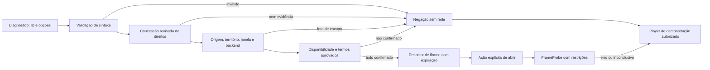

# EmbedWave — avaliação técnica, direitos e diagnóstico do NOCTA

Data da consulta e dos testes: **01/11/2026**. Projeto: `C:\Users\PC\Desktop\fuzz`.

## Resultado e recomendação

**O adaptador de URLs e o diagnóstico estão implementados; a integração real da EmbedWave não está homologada nem habilitada no catálogo.** A configuração distribuída não contém nenhuma concessão de direitos para esse fornecedor. Nenhum iframe ou rota de reprodução da EmbedWave foi acessado durante a investigação e os testes.

A incorporação por iframe é tecnicamente compatível com a estrutura do projeto. Isso foi demonstrado com uma página controlada e um curta licenciado, não com o player do fornecedor. **Não há evidência suficiente para aprovar a viabilidade jurídica da distribuição de obras por essa integração:** faltam autorizações aplicáveis ao conteúdo, às fontes efetivas e ao uso pretendido. Isso não constitui uma conclusão de ilegalidade de todo uso do serviço.

Recomendo manter a EmbedWave restrita ao diagnóstico e desativada para exibição até haver evidência revisada de direitos, disponibilidade e condições operacionais. O catálogo TMDB e os três curtas autorizados continuam funcionando independentemente dessa avaliação.

## 1. Documentação e termos atuais

Foram lidas a [documentação oficial](https://embedwave.cc/docs), os [termos oficiais](https://embedwave.cc/terms) e o [guia de incorporação](https://embedwave.cc/how-to-embed-movies). A primeira leitura direta dos termos falhou no leitor web; a navegação pelo link oficial e a confirmação HTTP posterior obtiveram a página.

### Parâmetros publicados

| Elemento | Contrato documentado |
|---|---|
| Filme | `/embed/movie/{tmdb_id}` |
| Episódio | `/embed/tv/{tmdb_id}/{season}/{episode}`; ID da série, temporada e episódio obrigatórios, iniciados em 1 |
| `server` | Opcional: `nxsha` (primeiro/padrão), `cinesrc` ou `videasy` |
| `autoplay=1` | Solicita início automático; o navegador pode exigir interação |
| `nobrand=1` | Remoção de identificação reservada a parceiros; não implementada |

As rotas, parâmetros e ausência de chave/cadastro são descritos na [documentação](https://embedwave.cc/docs). O [guia](https://embedwave.cc/how-to-embed-movies) sugere tela cheia, PiP, permissões de autoplay/mídia criptografada e `referrerpolicy="no-referrer"`; atributos delegam capacidades, não direitos sobre obras. Não foi encontrado nas páginas lidas um contrato de eventos de progresso, consulta de licença ou API de disponibilidade. Não foram inventados endpoints nem um protocolo de mensagens para o fornecedor.

O [site do fornecedor](https://embedwave.cc/) anuncia ausência de anúncios e compatibilidade móvel. São declarações do fornecedor, **não resultados de uma auditoria do player ou das fontes externas**. Nenhuma publicidade foi implementada neste projeto.

### Termos relevantes

Os [termos](https://embedwave.cc/terms) descrevem encaminhamento para fontes públicas de terceiros, sem hospedagem própria de vídeos e sem garantia de legalidade, qualidade ou disponibilidade dessas fontes. Também informam prestação gratuita sem garantia de uptime, proíbem uso ilícito e condicionam proxy, revenda ou apresentação como API própria a acordo escrito. Preveem bloqueio por tráfego abusivo, limitações de responsabilidade e mudanças posteriores dos termos.

**Interpretar:** acesso gratuito e um identificador aceito não são comprovação de licença de exibição. A abstração TypeScript criada aqui é um cliente local de diagnóstico, sem proxy, revenda ou redistribuição de URLs internas. O uso comercial ou de marca do serviço exigiria avaliar as condições aplicáveis e eventual acordo específico.

### Registro da consulta HTTP

Somente `/docs` e `/terms` receberam confirmação HTTP direta. Ambas responderam **200**, `text/html; charset=utf-8`. SHA-256 do HTML decodificado e convertido para UTF-8:

- Docs: `d4135348384d3b2c159c6b460f9a3e0d776aee48894b198e9d0d1b3e6aa8a114`.
- Terms: `29cd9cb10b0f4cf2656aaf05027fbafc34e787841147e8212048696d51242a14`.

Essas respostas não apresentaram cabeçalhos X-Frame-Options ou CSP. **Isso não informa os cabeçalhos das rotas `/embed/*`, de redirecionamentos ou dos backends.** Os hashes identificam a leitura desta sessão; não são um compromisso de versão do fornecedor. O repositório de exemplos vinculado na documentação retornou 404 no leitor web.

## 2. Como abrir o diagnóstico

```powershell
cd C:\Users\PC\Desktop\fuzz
npm run dev
```

Abra **http://127.0.0.1:5173/diagnostico/reproducao**.

A rota não aparece como card, botão de reprodução ou aba do catálogo. É uma área técnica separada, **não uma área autenticada ou privada**. Não foram adicionadas contas.

Há dois testes distintos:

1. **EmbedWave:** formulário de tipo, ID, temporada/episódio, backend, território e solicitação de autoplay. A URL prevista é somente texto. A ação verifica a política local; com a configuração entregue, retorna ausência de licença sem abrir iframe ou consultar o fornecedor.
2. **Iframe controlado:** um botão abre uma página do próprio projeto com Big Buck Bunny. O protocolo de mensagens dessa página confirma carregamento e reprodução exclusivamente da amostra. Não é um teste da EmbedWave.

Existe alternativa explícita para `/assistir/demo-bunny`, usando o player HTML5 original. Não há troca silenciosa de obra, backend, domínio ou licença.

## 3. Abstração e validação de direitos/disponibilidade

Arquivos principais, com caminhos relativos à raiz do projeto:

| Arquivo | Papel |
|---|---|
| `src/services/authorizedPlayback.ts:4` | Porta genérica `LicensedPlaybackProvider<Request, Session>` e decisões de prontidão/negação |
| `src/services/authorizedPlayback.ts:23` | Validação de evidência, escopo, datas, termos e disponibilidade |
| `src/services/embedwave.ts:11` | Validação estrita de parâmetros e rejeição de opções não documentadas |
| `src/services/embedwave.ts:22` | Construção pura da URL; não realiza requisições |
| `src/services/embedwave.ts:31` | Adaptador EmbedWave, separado do catálogo |
| `src/config/playbackRights.ts:6` | Manifesto revisado, entregue com `grants: []` e uso não aprovado |
| `src/pages/PlaybackDiagnostics.tsx:10` | Página de diagnóstico e consentimento de abertura após validação |
| `src/components/FrameProbe.tsx:19` | Iframe, prazo, expiração, mensagens verificadas e alternativa autorizada |
| `public/diagnostics/licensed-frame.html` | Página controlada do curta de demonstração |

Para retornar um descritor de iframe, a política exige:

- Concessão correspondente ao filme ou ao episódio exato **e ao backend selecionado**.
- Referência de evidência e responsável pela revisão; nenhuma concessão é gerada a partir do TMDB.
- Janela de autorização vigente, origem exata e território contemplados.
- Permissões de incorporação e exibição.
- Aprovação separada do uso/termos e confirmação da política sem publicidade.
- Registro vigente de disponibilidade, com referência, data de verificação e expiração.

Uma licença de filme não autoriza automaticamente um episódio, outro backend ou outra origem. O descritor expira na primeira expiração entre direitos e disponibilidade; o componente remove o iframe expirado. Mudanças no formulário invalidam a avaliação anterior.

**Disponibilidade:** não existe uma verificação remota inventada. O adaptador exige um registro previamente revisado, porque não foi identificado um endpoint oficial adequado. “Pronto para tentar carregar” não significa “reproduzindo”. Uma falha real ainda pode ocorrer depois da avaliação.

**Limite de confiança:** essa política é uma referência funcional em frontend, não uma fronteira de segurança ou verificação automática da autenticidade de contratos. Não há caixa de autodeclaração, importação de licença pelo formulário ou autorização via localStorage. Em produção, um serviço confiável deve aplicar a decisão, verificar documentos, revogações e escopo; o frontend deve receber somente a decisão e referências não sensíveis. Não colocar contratos privados ou credenciais no bundle.



O `PlaybackProvider` MP4 anterior permanece intacto em `src/services/playback.ts`. As telas públicas não passaram a consultar a EmbedWave nem associar automaticamente seus IDs TMDB a mídia.

## 4. Tratamento de falhas e políticas de navegador

| Situação | Comportamento implementado |
|---|---|
| ID inválido ou opção não suportada | Rejeição antes de montar descritor |
| Ausência/expiração de licença | Negação e ausência de iframe |
| Origem, território, episódio ou backend fora de escopo | Negação específica |
| Disponibilidade desconhecida, vencida ou negativa | Negação específica; sem sondar o acervo |
| Erro de navegação emitido | Mensagem de falha e alternativa; não é o único mecanismo de detecção |
| Iframe sem confirmação | Prazo de 12 segundos e resultado inconclusivo |
| Recebimento de `load` | Somente navegação concluída; não confirma player funcional |
| Expiração após abertura | Iframe removido |
| CSP/X-Frame-Options/sandbox | Políticas mantidas, sem proxy ou reescrita de respostas |
| Mensagem externa inesperada | Ignorada; o protocolo aceito pertence somente à página de teste |

A [referência do iframe](https://developer.mozilla.org/en-US/docs/Web/HTML/Reference/Elements/iframe#error_and_load_event_behavior) explica que navegadores não fornecem `error` confiável e podem disparar `load` mesmo em falhas. Por isso, a aplicação não promete distinguir programaticamente falha de rede, bloqueio de incorporação e tela de erro remota sem um protocolo suportado.

O iframe usa `no-referrer` e permissões documentadas, sem desabilitar políticas do navegador. O sandbox externo permite scripts/origem do fornecedor, mas não popups, navegação do topo, formulários ou downloads. Se um upstream exigir outras permissões ou recusar o sandbox, a compatibilidade fica pendente: não há relaxamento automático.

A [política de mesma origem](https://developer.mozilla.org/en-US/docs/Web/Security/Defenses/Same-origin_policy) limita leitura do DOM e estado de frames externos. Não foram extraídos URLs internos, duração, tracks ou progresso da EmbedWave. O protocolo `nocta-fixture-v1` verifica janela de origem, origin e desafio aleatório; não é apresentado como SDK do fornecedor.

Os bloqueios de [X-Frame-Options](https://developer.mozilla.org/en-US/docs/Web/HTTP/Reference/Headers/X-Frame-Options) e [CSP frame-ancestors](https://developer.mozilla.org/en-US/docs/Web/HTTP/Reference/Headers/Content-Security-Policy/frame-ancestors) foram exercitados em respostas locais controladas. Não foram modificados cabeçalhos ou políticas do fornecedor. CORS não foi tratado como uma autorização de direitos ou como substituto de política de incorporação.

## 5. Reprodução de teste autorizada

A página controlada reproduz Big Buck Bunny, com créditos e link de licença preservados, usando a amostra pública Google Cast já adotada no protótipo. O [projeto Blender](https://peach.blender.org/about/) publica a licença CC BY 3.0; a [Creative Commons](https://creativecommons.org/licenses/by/3.0/) explica a permissão de compartilhar com atribuição e as condições aplicáveis.

A leitura direta atual da página Blender falhou com HTTP 402 no leitor; a fonte primária aparece no índice e já havia sido verificada na entrega anterior. A licença publicada e os créditos foram mantidos, sem nova tentativa de superar essa resposta. Não foram usadas capas oficiais excluídas da licença ou retirados os créditos finais do filme.

Essa autorização do curta **não foi usada como confirmação de disponibilidade/licença de uma fonte EmbedWave**. Nenhum ID, mesmo de uma obra aberta, foi liberado no manifesto do fornecedor sem evidência da fonte efetiva.

## 6. Testes e compatibilidade comprovada

### Escopo real

- Testes unitários/de integração: regras de direitos, expiração, escopo, disponibilidade, sintaxe, ausência de rede, mensagens inválidas, timeout e regressão das funcionalidades anteriores.
- Navegadores instalados: Microsoft Edge desktop e Google Chrome desktop, ambos da família Chromium.
- Móvel: emulação Pixel 7 de viewport/toque/UA no navegador desktop. **Não é teste em aparelho Android, Safari/iOS ou WebView real.**
- Aplicação testada a partir do build de produção em porta exclusiva, sem HMR alterando os testes.

| Caso | Edge desktop | Chrome desktop | Viewport móvel |
|---|---|---|---|
| Rota de diagnóstico e bloqueio sem licença | Aprovado | Aprovado | Aprovado |
| Nenhuma requisição à EmbedWave no fluxo testado | Aprovado | Aprovado | Aprovado |
| Reprodução real do curta no iframe controlado | Aprovado | Aprovado | Aprovado |
| Isolamento do iframe sandboxed da página pai | Aprovado | Aprovado | Aprovado |
| Resposta local `X-Frame-Options: DENY` respeitada | Aprovado | Aprovado | Aprovado |
| Resposta local `frame-ancestors 'none'` respeitada | Aprovado | Aprovado | Aprovado |
| Alternativa autorizada disponível após bloqueio | Aprovado | Aprovado | Aprovado |
| Home, busca, filtros, favoritos, temporadas e retomada original | Aprovado | Aprovado | Aprovado |
| Player/headers/DRM/upstreams reais da EmbedWave | Não testado | Não testado | Não testado |

Os testes de bloqueio usam a página própria servida com cabeçalhos restritivos pelo harness. O console do navegador confirma a recusa, enquanto a UI registra falta de confirmação. Isso evita rotular incorretamente `load` como êxito.

Uma falha intermediária ocorreu durante edição/HMR da página enquanto a primeira suíte estava em execução. A suíte final foi transferida para o build de produção estável, sem alterar ou desabilitar proteções. O resultado final da execução e os artefatos compilados são registrados ao final deste documento.

Capturas: `test-results/diagnostic-desktop.png`, `test-results/diagnostic-chrome-desktop.png` e `test-results/diagnostic-mobile.png`.

## 7. Viabilidade técnica e jurídica

| Dimensão | Avaliação |
|---|---|
| Construção das URLs e integração React | Implementada e testada sem acessar conteúdo do fornecedor |
| Iframe responsivo e alternativa licenciada | Comprovados com fixture própria |
| Serviço EmbedWave em produção | Não homologado; falta teste autorizado do player real e suas fontes |
| Autoplay, fullscreen, PiP | Permissões/solicitação não garantem funcionamento; dependem de navegador e fonte |
| Retomada/progresso externo | Não implementados sem protocolo oficial documentado; o progresso MP4 anterior permanece |
| Disponibilidade do acervo | Não demonstrada e não descoberta por varredura |
| Garantia de ausência de publicidade | Alegação do fornecedor; não auditada em runtime |
| Direitos de exibição via EmbedWave | Não comprovados para nenhum item deste projeto |
| Android real, Safari/iOS e Firefox | Compatibilidade ainda não validada |

Para reavaliar a habilitação, seriam necessários, por obra/fonte: cadeia de autorização verificável, permissão de incorporação e exibição, janela/territórios, origens e plataformas contempladas, backend efetivo autorizado, confirmação operacional e política publicitária. As condições gerais publicadas não substituem esses documentos. Alterações/revogações precisam ser verificáveis fora do frontend.

**Recomendação:** não conectar a EmbedWave ao catálogo público nesta etapa. Manter o diagnóstico e os curtas licenciados. Com as autorizações e condições confirmadas, realizar uma homologação limitada, sem sondagem em massa, respeitando as restrições de iframe e sem prometer disponibilidade ou direitos por associação com TMDB.

## 8. Comandos e arquivos

```powershell
npm test
npm run build
npm run test:e2e
npm run android:sync
```

Os testes E2E usam uma prévia de produção em `127.0.0.1:5175`, isolada da prévia de desenvolvimento `5173`. Não requerem chave TMDB nem acesso a catálogo EmbedWave. Fazem streaming somente da amostra autorizada.

Novos arquivos: `src/services/authorizedPlayback.ts`, `src/services/embedwave.ts`, `src/config/playbackRights.ts`, `src/components/FrameProbe.tsx`, `src/pages/PlaybackDiagnostics.tsx`, `public/diagnostics/licensed-frame.html`, `src/test/embedwave.test.ts`, `src/test/iframe-diagnostics.test.tsx` e `e2e/iframe.spec.ts`. Foram atualizados roteamento, estilos e configuração E2E. Nenhum SDK publicitário foi adicionado.

## Registro final da validação

- **42 testes unitários/de integração aprovados** em seis arquivos, incluindo os 14 testes originais.
- **15 cenários de navegador aprovados** na suíte final sobre build de produção: cinco por perfil (Edge desktop, Chrome desktop e viewport móvel).
- **Build TypeScript/Vite aprovado**, com 30 arquivos distribuíveis.
- Verificação adicional do avanço real do tempo do curta no iframe: três execuções aprovadas, uma por perfil, além da suíte de 15 cenários.
- **APK Android debug atualizado e compilado com sucesso**, sem execução em aparelho: `android/app/build/outputs/apk/debug/app-debug.apk`.
- APK: 4.308.883 bytes, SHA-256 `450078d47ee0a5d3279d9f08ebc24d17d7e12098f4a255865381725e9a16019f`.
- Os 30 arquivos de `dist/` foram comparados aos membros do APK e coincidiram byte a byte.
- **Zero requisições à EmbedWave nos fluxos de navegador testados**; somente documentação/termos foram consultados na investigação.

Não foram testadas fullscreen/PiP/autoplay do player real da EmbedWave, nem seu comportamento de cookies, anúncios, DRM, disponibilidade, redirecionamentos ou conformidade de cada upstream. O APK foi compilado, mas não homologado em dispositivo Android real.
