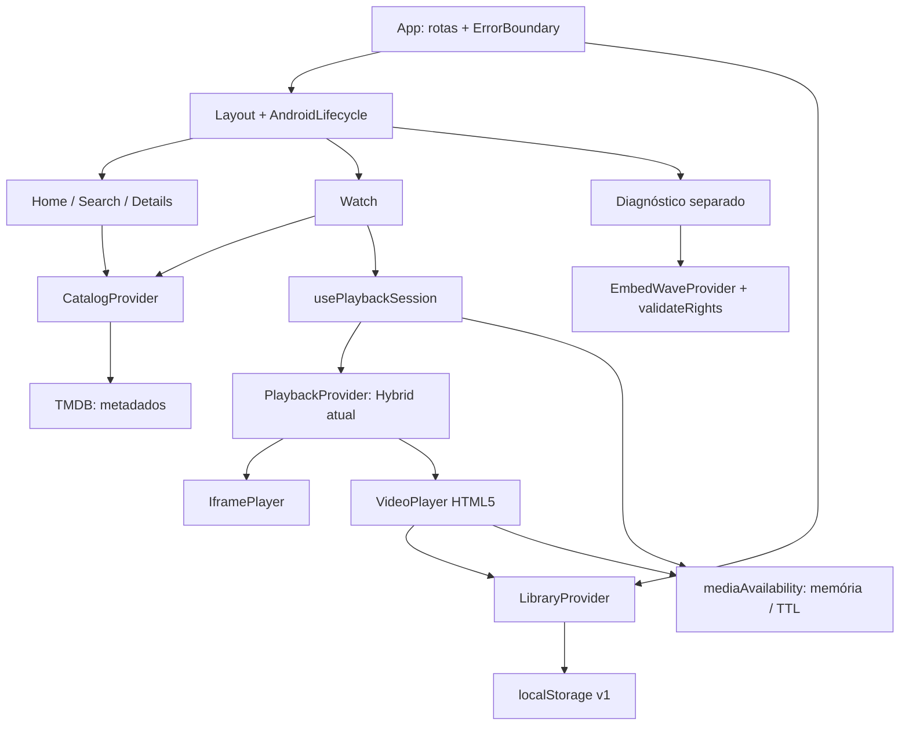

# NOCTA — mapa do MVP e próximos incrementos

Data da análise: 03/11/2026. Projeto existente: `C:\Users\PC\Desktop\fuzz`.

## 1. Escopo e grau de evidência

Este documento orienta incrementos **no aplicativo atual**, sem criar outro projeto. Foram lidos os arquivos solicitados, os contratos de domínio, hooks, configuração web/Android, scripts e testes relacionados. Os caminhos continuam válidos. Nenhuma funcionalidade, recurso visual, dependência ou configuração do aplicativo foi alterada nesta análise.

**Comprovado nesta execução:** leitura do código, execução de `npm test`, comparação binária dos arquivos web e inspeção do APK como ZIP. Não foi executado o APK, iniciado emulador, instalado aplicativo, acessado player externo ou testada reprodução de uma obra. Resultados antigos em `VALIDACAO.md` e `RELATORIO_ANDROID.md` são históricos, não novas verificações.

Legenda usada abaixo: **evidência estática** descreve código presente; **lacuna** descreve implementação ausente; **risco** requer reprodução dirigida ou validação em aparelho. Aprovação dos testes simulados não confirma disponibilidade ou direitos de um título externo.

## 2. Arquitetura atual

Aplicação React SPA com Vite, TypeScript, React Router, Tailwind e CSS próprio. Capacitor carrega a mesma aplicação em Android. Sem backend próprio, login, assinatura ou integração de publicidade.

`package.json` declara intervalos de versões; o ambiente instalado nesta análise possui React **19.3.1**, Vite **7.3.7**, TypeScript **5.9.3** e Capacitor core/android/cli **7.6.10**. Não confundir versões mínimas declaradas com versões efetivamente instaladas. Puppeteer aparece como dependência, mas não é necessário ao fluxo de reprodução das telas.



**Separação importante:** o ramo de diagnóstico com `validateRights` não protege automaticamente o ramo principal `HybridPlaybackProvider`. É a principal dívida a resolver antes de monetizar ou prometer reprodução.

### Serviços e modelos

| Área | Evidência no projeto | Estado e preservação |
|---|---|---|
| Domínio | `src/domain/media.ts` | `MediaKind` só contém `movie` e `tv`; `Media`, temporadas, episódios e `CatalogRail` já são reutilizáveis. Anime/novela devem ser classificações editoriais sobre títulos, sem quebrar IDs e temporadas. |
| TMDB | `src/services/catalog.ts:19`, `:45`, `:64` | Validação de listagens; tendências diárias, fallback para populares e quatro coleções Discover. Português, cancelamento e timeout de 10 s. Preservar. |
| Busca | `src/services/catalog.ts`, `src/pages/Search.tsx` | `search/multi`, exclui pessoas; debounce de 350 ms e parâmetros na URL. Só primeira página; filtros e ordenação são locais sobre o conjunto recebido. |
| Reprodução | `src/services/playback.ts:1`, `:40`, `:78` | Contrato substituível; instância pública híbrida monta iframe MyEmbed para IDs TMDB. Não verifica licença, catálogo do fornecedor ou início efetivo. Demos explícitas separadas. |
| Direitos | `src/services/authorizedPlayback.ts`, `src/services/embedwave.ts`, `src/config/playbackRights.ts` | Diagnóstico EmbedWave verifica concessão/escopo/validade/disponibilidade. `grants` vazio; `termsApproved` está true, o que não equivale a licença. `EmbedMovieProvider` aceita política mas não a aplica. |
| Disponibilidade | `src/services/mediaAvailability.ts:12` | Map em memória, TTL 30 min, assinatura React. Falhas de episódio têm chave própria. Não é inventário de mídia nem validação preventiva do fornecedor. |
| Biblioteca | `src/state/library.tsx:7` | `nocta.library.v1`: favoritos e progresso em ms, por título/episódio. Recuperação de JSON inválido, aviso de storage bloqueado e sincronização entre abas. |

## 3. Telas e rotas

Referência central: `src/App.tsx`. Navegação definida em `src/components/Layout.tsx`.

| Rota | Tela e comportamento |
|---|---|
| `/` | Home: capa direta, Continue assistindo se houver progresso, tendências e trilhos temáticos. |
| `/filmes` | Home filtrada por filmes. |
| `/series` | Home filtrada por séries. |
| `/buscar` | Busca; `q`, `tipo`, `genero`, `ano`, `ordem` na URL. |
| `/minha-lista` | Favoritos e histórico local; oculta fixtures antigas sem apagá-las. |
| `/titulo/:id` | Details: descrição, elenco, gêneros, temporadas; ação de assistir depende de sessão retornada, não de prova de autorização. |
| `/assistir/:id` | Watch; seleção por `temporada` e `episodio`. Detalhes rápidos e episódios na mesma tela. |
| `/sobre` | Créditos e atribuição TMDB. |
| `/diagnostico/reproducao` | Diagnóstico de direitos e iframe controlado, fora da navegação normal. |
| `/diagnostico/player/:id` | Player com providers de demonstração explícitos. |
| demais | Estado de página não encontrada. |

Não existem telas próprias de Animes, Novelas, recomendações personalizadas ou publicidade. Animes já têm um trilho por animação + origem JP + idioma ja; é aproximação editorial, não cobertura garantida de todos os animes. Novelas podem aparecer incidentalmente como séries, mas não há organização específica.

## 4. Fluxos de dados existentes

### Descoberta e pesquisa

1. Home solicita `home(kind)` e `collections(kind)` independentemente por `useAsync`, preservando cancelamento ao desmontar.
2. Tendências usam `trending/all/day` ou por tipo; em erro tentam populares. Coleções usam Ação (filme), Drama (TV), Animes (TV) e Terror/Suspense (filme), ordenadas por popularidade.
3. Registros inválidos, adultos, pessoas e duplicatas são excluídos das listagens. `isPublicMedia` e falhas conhecidas refinam a apresentação. Metadado válido não é fonte disponível.
4. Sem chave configurada, a interface fica vazia com orientação; não injeta catálogo fictício. A chave Vite fica no bundle público: não imprimir valores nem tratar `.env` como proteção do JavaScript distribuído.
5. Hero e cards abrem o player; Detalhes é ação secundária. Busca com gênero sem texto refina apenas tendências recebidas, podendo aparentar um acervo muito menor que o real.

### Seleção → reprodução

1. Watch carrega detalhe; séries usam seleção da URL, último episódio salvo ou primeiro disponível como ponto inicial.
2. `usePlaybackSession` resolve uma sessão com AbortController e ignora resposta atrasada. Mantém o episódio anterior enquanto prepara o novo; falha permite tentar novamente.
3. `IframePlayer` conserva restrições `allow-scripts allow-same-origin allow-presentation`, sem popups, com `no-referrer` e permissões de reprodução existentes. Ajuste de escala não lê o DOM externo e não recarrega o iframe.
4. `PlaybackDetails` é expansão nativa: sinopse, elenco e ano sem desmontar o player. `EpisodePicker` muda episódios com um toque, usando números de exibição, não IDs de banco.
5. HTML5 fornece tempo real, retomada, persistência, sugestão nos últimos 90 s (máximo 30% da duração nos curtos), dispensa e avanço em `ended`. `episodeSequence` passa à próxima temporada sem inventar episódio após o final.
6. No iframe atual, não há integração oficial implementada de progresso/fim. Não se salva posição real, não se detectam créditos e não se pode prometer avanço automático. Botão manual continua funcional pelo contrato de URL, sem prova de reprodução real.

### Favoritos e Continuar assistindo

`LibraryProvider` mantém snapshots de `Media`. `progressKey` usa título ou título + temporada/episódio. HTML5 salva em intervalos de 5 s, pause/seek/fim e saída/segundo plano. Continue assistindo escolhe o último registro de cada obra, exige pelo menos 1 s e menos de 95% concluído, aparece antes dos demais trilhos abaixo da capa e funciona mesmo se o catálogo falhar. Não converter simples abertura de iframe em progresso assistido.

### Futuro anúncio antes do conteúdo — ainda não implementado

Fluxo proposto: **seleção → direitos confirmados → disponibilidade elegível → anúncio de teste/fornecedor autorizado → liberar sessão do conteúdo → progresso**. Não montar iframe de conteúdo antecipadamente enquanto o anúncio estiver na tela. Cancelamento, retorno do app, ausência de anúncio, falha e timeout precisam de decisões explícitas; não cobrar atenção por conteúdo já conhecido como indisponível. Política do anúncio do app deve ficar separada de publicidade interna do fornecedor. O gate atual de diagnóstico exige fonte sem publicidade: não alterar essa regra silenciosamente para acomodar um pre-roll próprio.

## 5. Componentes e lógica a preservar

| Arquivo | Uso já pronto |
|---|---|
| `components/Layout.tsx`, `AndroidLifecycle.tsx` | Shell, cinco abas, Voltar, saída de fullscreen, minimizar na home, eventos de segundo plano e limpeza de listeners. |
| `components/Hero.tsx`, `MediaCard.tsx`, `Carousel.tsx` | Acesso direto, favoritos, detalhes secundários, ranking e trilhos horizontais. Expandir via dados, sem duplicar telas por gênero. |
| `components/IframePlayer.tsx` | ResizeObserver, ajuste uniforme, modo natural mais alto, fullscreen com erro amigável; preservar iframe ao alternar controles. |
| `components/VideoPlayer.tsx` | Controles HTML5, retomada em ms, callbacks reais de progresso/fim, persistência e pausa em background. |
| `components/PlaybackDetails.tsx`, `EpisodePicker.tsx` | Detalhes sem sair da tela, navegação de temporadas independente da sessão ativa, estado selecionado e preparação. |
| `hooks/usePlaybackSession.ts`, `useAsync.ts` | Cancelamento, defesa contra respostas fora de ordem e retry. |
| `domain/episodes.ts`, `state/library.tsx` | IDs compostos, compatibilidade da biblioteca v1, sequenciamento entre temporadas e fim de série. Não resetar storage nas migrações. |
| `components/Feedback.tsx`, `FrameProbe.tsx` | Estados vazios/falha e diagnóstico que distingue load de reprodução. Reutilizar conceitos, não assumir protocolo do fixture como protocolo externo. |
| `src/styles.css` | Tema original, snap/scroll horizontal, áreas seguras, redução de movimento e controles de toque. Evitar nova cascata de overrides duplicados. |

## 6. Bugs, lacunas e ordem de correção

As prioridades seguintes são recomendações desta análise; nenhum reparo foi aplicado neste prompt.

### Críticas — antes de ampliar distribuição ou inserir anúncio

1. **Autorização e readiness desconectadas (evidência estática).** `HybridPlaybackProvider.resolve` retorna sessão para ID TMDB sem consultar o gate. `Details` chama o resultado de `authorizedPlayback`; Watch exibe “Disponível sob MyEmbed Player”, mas nome de fornecedor não comprova licença. `EmbedMovieProvider.assess` ignora política/contexto e devolve referências fixas. Unificar avaliação tipada e impedir essas falsas conclusões; reutilizar contrato e validações já existentes.
2. **Validação permissiva no provider público (evidência estática).** Em `playback.ts:40`, falha no regex ainda permite extrair o primeiro número do ID; temporada/episódio não recebem validação equivalente à do domínio. Restringir entradas e preservar testes de números seguros.
3. **Reprodução externa sem confirmação (lacuna).** IframePlayer não possui handshake documentado de erro/início/progresso, timeout de readiness ou estado de indisponibilidade interna. Não reutiliza FrameProbe. Acrescentar estados explícitos e adapter oficial, se disponível; `load` não deve declarar sucesso. Não contornar origem, DRM ou políticas do WebView.
4. **Falha pode ser limpa cedo (evidência estática; efeito a testar).** `usePlaybackSession.ts` chama `clearMediaFailure` assim que recebe uma sessão. No híbrido isso é só uma URL, não reprodução bem-sucedida. Separar “sessão resolvida” de “mídia começou” e limpar falhas no sinal apropriado.

### Importantes — alcance do catálogo e confiabilidade

5. **Busca limitada à primeira página (confirmado no serviço).** Sem `page`, total de páginas ou descoberta remota por filtros. Falso vazio ao filtrar a página atual é limitação esperada hoje. Adicionar paginação, filtros no serviço e contexto claro dos resultados.
6. **Muitos trilhos e recomendações ausentes.** Quatro coleções fixas; sem recomendações por título ou motor pessoal. Tornar trilhos configuráveis, carregados progressivamente e com deduplicação; definir critério editorial para novelas e ampliar anime sem supor que qualquer animação japonesa cobre a categoria inteira.
7. **Sem cache compartilhado.** Home, Details, Watch, sequência e seletor podem repetir detalhe/temporada. Implementar cache/deduplicação com expiração, cancelamento e atualização sem perder sessão ativa.
8. **Details contradiz o player (evidência estática).** Episódios em `Details.tsx` são somente informativos e dizem “reprodução não vinculada”, mesmo quando o híbrido oferece Assistir. Alinhar ao resultado de avaliação e permitir link com temporada/episódio após validação.
9. **Biblioteca com snapshots e validação parcial (risco).** `validMedia` não valida todos os campos, `updatedAt` não é validado e snapshots podem envelhecer. Endurecer leitura/migração e reidratar metadados sem apagar favoritos/progresso. Falhas temporárias não devem excluir favoritos.
10. **Anúncio prévio inexistente (lacuna).** Não há SDK, contrato AdProvider, frequência ou máquina de estados. Projetar e testar com anúncio simulado primeiro; integrar somente depois dos itens críticos e da decisão explícita sobre fornecedor/uso permitido.

### Polimento e regressões documentadas

- Queixas históricas de iframe cortado, controles pequenos e necessidade de sair do player motivaram os componentes atuais. Há correções e testes simulados; **não considerar a interface real do fornecedor validada no aparelho**.
- TS2724 e incompatibilidades EmbedWave/MyEmbed foram corrigidos anteriormente; o resultado atual dos testes e do typecheck deve ser a referência, preservando as duas APIs separadas.
- CSS tem regras repetidas para watch/fullscreen e breakpoints; Voltar ainda pode receber 44 px no override mobile apesar da regra geral de 48 px. Consolidar após estabilizar comportamento.
- README contém trechos históricos conflitantes: seção final ainda diz 60 s, enquanto o código usa 90 s; afirmações de emulador não validam este APK em dispositivo físico. Sua seção de arquitetura antiga também pode induzir leitura errada do provider ativo. Atualizar na etapa documental.
- Concessão vazia do diagnóstico não prova que o player público está bloqueado. Separar claramente os dois ramos na documentação e nos testes.

## 7. Fonte, build web, cópia Android e APK existente

Inspeção sem executar ou reconstruir o APK:

| Camada | Resultado desta análise |
|---|---|
| Fonte | `src/`, configurações e scripts são editáveis. Nenhum arquivo de runtime em `src` tem mtime posterior ao `dist/index.html` observado; datas sozinhas não provam origem exata do build. |
| Web | `dist/` contém **31 arquivos**. `index.html` tinha mtime local `03/11/2026 14:56:10`. Build não foi refeito nesta análise para preservar os artefatos inspecionados. |
| Capacitor | Os 31 arquivos têm conteúdo idêntico em `android/app/src/main/assets/public`. Há também `cordova.js` e `cordova_plugins.js`, gerados pela integração. |
| APK | Existe em `C:\Users\PC\Desktop\fuzz\android\app\build\outputs\apk\debug\app-debug.apk`, **4.535.557 bytes**. Os mesmos 31 arquivos web dentro de `assets/public/` coincidem byte a byte com dist, sem ausências/divergências; os dois arquivos Cordova também aparecem como extras. |

SHA-256 atual do APK: `a0f6c4709e9004e005c1e78da1638247a94ad0a89a5ccef6a74650598a014ffd`.

O APK atual **não deve ser declarado desatualizado com base nos relatos antigos**: seus assets conferem com o dist observado. Entretanto, isso não atesta equivalência de todo o código Java, assinatura, build reproduzível, instalação ou runtime. Não foi verificado qual APK está no telefone. Uma futura entrega deve registrar hash, versão e evidência de teste físico do mesmo binário.

Configuração encontrada: `capacitor.config.ts` usa `webDir: dist`, appId `app.nocta.prototype`, fundo escuro e ajuste automático de margens. Android: min SDK **23**, compile/target **35**, versionCode **2**, versionName **1.1**, AGP **8.7.2**, wrapper Gradle **8.11.1**. Script de build exige JDK 21 e SDK 35. Manifesto-fonte declara somente permissão INTERNET; conferir também o manifesto mesclado em futura integração de SDKs. MainActivity implementa fullscreen via custom view e insets. Não há servidor remoto configurado como app em produção.

## 8. Testes executados e comandos corretos

**Resultado atual:** `npm test` terminou com código 0, **77 testes aprovados em 10 arquivos**, duração reportada **17,25 s**. `android.test.tsx` usa mocks do plugin: não é teste nativo. Setup esvazia a chave TMDB; dados, mídia e permissões são simulados nos testes de unidade/integração. Não houve reprodução externa nesta execução.

Comandos na raiz do projeto:

```powershell
npm test
npm test -- src/test/episode-navigation.test.tsx src/test/playback-library.test.tsx src/test/iframe-diagnostics.test.tsx
npx tsc --noEmit --incremental false -p tsconfig.json --pretty false
npm run dev
npm run build
npm run preview
```

**Typecheck sem emissão aprovado:** `npx tsc --noEmit --incremental false -p tsconfig.json --pretty false` terminou com código 0 e sem diagnósticos. `npm test` não faz verificação completa de tipos; `npm run build` executa `tsc -b` e Vite e altera `dist`.

Para testes de navegador controlados, quando solicitados:

```powershell
npx playwright test e2e/platform.spec.ts --project=mobile --project=desktop
npx playwright test e2e/watch-mobile.spec.ts --project=mobile
```

O projeto mobile do Playwright é viewport de navegador, **não Android/WebView**. Configuração padrão serve porta 5175, usa Edge nesses projetos e chave fictícia no build E2E. `platform` e `watch-mobile` interceptam TMDB/iframe e bloqueiam demais domínios. A suíte completa `npm run test:e2e` inclui `e2e/iframe.spec.ts`, que acessa uma amostra autorizada de vídeo: **não foi executada neste prompt**. Nenhum E2E foi reexecutado nesta análise. `.cache/catalog-qa.config.ts` é auxiliar local e depende de servidor separado; não é o comando padrão reproduzível do repositório. Após E2E, reconstruir com configuração normal antes de sincronizar Android.

Fluxo futuro de empacotamento, sem execução neste prompt:

```powershell
npm run android:sync
npm run android:build
```

O primeiro faz build web e cópia/plugin sync; o segundo repete sync e compila o APK via script. Nenhum instala no celular. `npm run android:open` apenas abre Android Studio. Para instalação física, seguir `TESTE_USB.md` com `adb -d`, autorização USB e interrupção em falhas. Não usar scripts de emulação/teste nativo durante este planejamento.

## 9. Checklist e prompts 01–12

Os textos dos próximos prompts não foram fornecidos. A sequência abaixo é **uma proposta numerada**, pronta para orientar os incrementos; não representa uma especificação previamente recebida. Todos devem operar neste projeto, preservar identidade/biblioteca e registrar evidência sem afirmar reprodução real quando houver apenas mock.

- [x] **Prompt 01 — Mapa e baseline (crítica).** “Mapeie o NOCTA existente, execute os testes e compare fonte, dist, cópia Capacitor e APK sem mudar funcionalidades.” Entrega: este documento e resultados precisos.
- [ ] **Prompt 02 — Baseline reproduzível (crítica).** “Corrija contradições documentais, registre versões/hashes e organize comandos de teste isolados e de USB. Preserve código funcional.” Aceite: README coerente, testes sem mídia externa por padrão, artefatos identificáveis.
- [ ] **Prompt 03 — Playback e autorização unificados (crítica).** “Conecte o provider público a avaliação explícita de direitos/escopo/disponibilidade, valide IDs estritamente e retire rótulos de licença fictícios.” Aceite: sem grant válido não montar mídia; mocks cobrem todos os bloqueios; demo autorizada preservada no diagnóstico.
- [ ] **Prompt 04 — Estados de reprodução e falha (crítica).** “Implemente preparar, pronto, iniciado, erro, timeout e retry sem tratar iframe load como sucesso; não limpar falhas só por construir URL.” Aceite: sessão anterior preservada; sinais reais ou estado não confirmado; nenhum contorno do WebView.
- [ ] **Prompt 05 — Catálogo paginado e cache (importante).** “Amplie o CatalogProvider com páginas, totais, descoberta remota e cache compartilhado com expiração.” Aceite: atualização sem duplicatas ou chamadas repetidas desnecessárias; cancelamento e falhas parciais preservados.
- [ ] **Prompt 06 — Muitos trilhos, animes e novelas (importante).** “Crie configuração editorial de trilhos com carregamento progressivo e classificação documentada de anime/novela sobre movie/tv.” Aceite: não duplicar app/telas, não confundir gênero com licença, validar cobertura com metadados autorizados.
- [ ] **Prompt 07 — Pesquisa completa (importante).** “Faça filtros remotos e paginação de busca, mantenha debounce/URL e diferencie vazio, falha e carregamento.” Aceite: filtros não se limitam silenciosamente à primeira página; testes de retorno/cancelamento.
- [ ] **Prompt 08 — Recomendações (importante).** “Adicione recomendações por título e trilhos baseados nas preferências locais, com critério explicável e opção de limpar histórico.” Aceite: resultados deduplicados, fallback honesto e nenhum envio externo de histórico sem decisão explícita.
- [ ] **Prompt 09 — Favoritos e retomada robustos (importante).** “Endureça schema/migração, timestamps e atualização de metadados sem perder biblioteca v1; mantenha progresso por episódio.” Aceite: retomada HTML5 real e distinção de último episódio aberto versus tempo assistido em iframe.
- [ ] **Prompt 10 — Séries e toque no aparelho (importante/polimento).** “Unifique episódios de Details/Watch, preserve próximo/temporada/URL e valide enquadramento e controles em telefone físico.” Aceite: autoavanço somente com sinal suportado; fonte anterior em falhas; sem corte e sem regressão de Voltar/fullscreen.
- [ ] **Prompt 11 — Anúncio antes de reprodução elegível (importante; depende de 03/04).** “Introduza AdProvider e máquina de estados, começando por anúncio simulado, antes de montar a mídia autorizada; trate cancelamento, ausência, falha e frequência.” Aceite: anúncio não repete em retry indevidamente, conteúdo não inicia atrás dele, política e requisitos do fornecedor definidos antes de SDK real.
- [ ] **Prompt 12 — Entrega Android via USB (crítica para release).** “Execute checks web, sincronize, compile APK debug e valide o mesmo hash em aparelho físico; registre testes reais e pendências.” Aceite: sem emulador, sem permissões adicionais não justificadas, APK/versionCode/hash identificados e nenhum relato de reprodução não realizada.

Ordem recomendada: **02 → 03 → 04 → 05 → 06/07 → 08/09 → 10 → 11 → 12**. Recursos editoriais podem ser desenvolvidos com mocks enquanto a autorização é resolvida; monetização e promessa de reprodução dependem da resolução das críticas.
