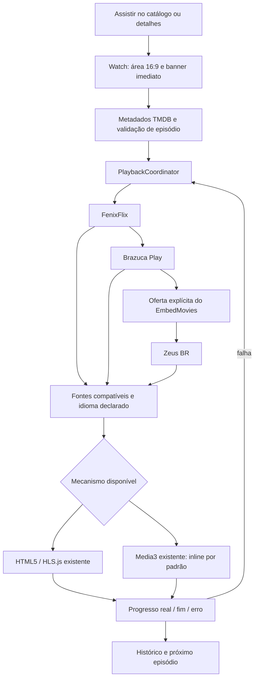

# NOCTA — recuperação e experiência de reprodução

> Incremento posterior de 05/11/2026: [fluxo, tamanho, servidores, retomada e Busca](NOCTA_PLAYER_FLUXO_CACHE.md). A implementação atual não possui a confirmação intermediária do EmbedMovies e deixa Zeus desativado por padrão. Os resultados abaixo registram a etapa anterior.

Atualizado em 05/11/2026. Projeto: `C:\Users\PC\Desktop\fuzz`.

## Resultado

O fluxo **normal** `/assistir/:id` voltou a reproduzir no Samsung SM-S911B. Não se trata apenas da tela experimental. Apenas um Show, Os Simpsons, Dr. House e Black Clover T1/E1 iniciaram pelo FenixFlix, com primeiro frame, avanço do áudio e progresso da mesma sessão. As capturas foram inspecionadas. O player ficou dentro da página, sem tela cheia automática.

A Brazuca retornou opções, mas as opções dubladas selecionadas para Simpsons e Dr. House falharam com HTTP 404. Esse resultado não foi convertido em sucesso nem atribuído a CORS/codec. O aplicativo ofereceu o EmbedMovies em seguida.

**Limite do diagnóstico original:** não havia logs preservados da tentativa do usuário que ficou sem imagem e som. Portanto, não é possível atribuir retrospectivamente aquela falha a uma única causa. Foram corrigidos defeitos locais reproduzíveis e validados os caminhos de reprodução. Isso não torna toda resposta externa reproduzível.

## Fase 0: inspeção, recuperação e preservação

- `git status --short -- .` mostrou a pasta inteira como não rastreada no repositório pai; `git diff --stat -- .` não forneceu uma base para comparar os arquivos do Nocta. Não existe `.git` próprio nesta pasta. Nenhum reset, clean ou descarte foi executado.
- A API instalada já expunha `load`, `play`, `pause`, `seek`, `close`, `updateControls` e `capabilities`. O WebView era um contexto seguro com `crypto.subtle.digest`. A ausência de registro do plugin não foi comprovada como causa.
- Uma falha em operações **opcionais** de diagnóstico/controles podia cair no mesmo tratamento de falha do carregamento, embora a mídia já tivesse sido enviada ao Media3. Essas falhas agora não provocam fallback.
- Cada montagem nativa recebe uma identidade de sessão exclusiva. O encerramento e os callbacks são filtrados por essa identidade; uma limpeza antiga não fecha uma reprodução nova. O próximo mecanismo aguarda o encerramento da sessão anterior.
- O HTML5 pausa ao desmontar. Autoplay bloqueado apresenta **Iniciar reprodução**, permitindo um gesto real; não é tratado como servidor quebrado. Progresso do fluxo normal exige saída de vídeo.
- Antes da nova apresentação, MP4/HLS controlados foram executados no fluxo normal do Samsung: HTML5 com quadros/áudio decodificados e Media3 com primeiro frame, áudio avançando e posição crescente.
- O tema `NoctaNativePlayerTheme` e os overlays transparentes que corrigiram o Malfoy foram preservados. O teste Android de transparência continua passando.

## Fluxo implementado



As setas entre fornecedores representam prioridade de seleção, não uma obrigação de esperar todas as consultas. O Fenix começa primeiro. A Brazuca começa em segundo plano após 700 ms; EmbedMovies e Zeus são preparados depois. Uma fonte rápida do Fenix pode iniciar imediatamente. Se o Fenix continuar lento, uma opção já disponível da Brazuca pode avançar após uma vantagem inicial limitada a 2,2 s. Resultados posteriores atualizam alternativas sem reiniciar o vídeo ativo.

Cada consulta Stremio possui orçamento de 6,5 s, inclusive se uma implementação ignorar cancelamento. A preparação da sessão EmbedMovies tem limite de 3 s. Sair da tela cancela as consultas. Esses limites de **consulta** são diferentes dos 45 s de inicialização/buffering de mídia.

### Seleção e fallback

1. FenixFlix.
2. Brazuca Play.
3. EmbedMovies, reutilizando a integração existente.
4. Zeus BR.

O manifesto configurado do Fenix mantém seu caminho de qualidades/áudios/catálogos. IDs IMDb vêm de `external_ids` do TMDB; temporada e episódio são preservados. Não são adivinhados IDs próprios dos complementos. O TMDB continua fornecendo somente metadados.

Fontes CAM/HDCAM/telesync são excluídas da seleção automática. A política de qualidade existente prioriza 1080p/720p para a inicialização, sem presumir suporte a qualquer codec/4K. Formato, origem explicitamente permitida e requisitos do mecanismo precisam ser reconhecidos. URLs com autenticação embutida, destinos privados, DRM, torrent e cabeçalhos não suportados não são habilitados artificialmente.

O fallback tenta no máximo duas fontes por fornecedor e não repete automaticamente identidades já tentadas na sessão. Uma URL com mais de 90 s é considerada antiga; existe uma atualização limitada por fornecedor. URLs de reprodução ficam apenas em memória. A escolha manual permite tentar uma fonte novamente, de forma explícita.

**Servidores** abre a lista e encerra o mecanismo anterior. A posição real é preservada quando o novo mecanismo permite seek. O botão fica indisponível apenas enquanto a coordenação ainda está sendo criada, evitando um toque sem efeito. **Problema com o vídeo?** executa a recuperação local. Não foi criado sistema de denúncias.

O EmbedMovies exige confirmação explícita quando o idioma da alternativa não é conhecido. `iframe.onload` significa somente documento carregado. Não prova imagem, áudio, disponibilidade ou término. Erro de documento/timeout e a ação manual de problema permitem prosseguir ao Zeus; um erro interno invisível do iframe não pode ser detectado sem API documentada. O sandbox e as permissões de fullscreen/PiP foram preservados.

### Idiomas

- Duas versões conhecidas antes do início: botões **Dublado** e **Legendado**, com fontes agrupadas.
- Uma versão compatível: início direto, sem seleção redundante.
- Nova versão encontrada depois do início: aparece no menu, sem interromper o vídeo.
- A preferência acompanha fallback e próximo episódio durante a sessão.
- Sem opção no idioma escolhido: mensagem e escolha explícita de outra versão; não há mudança silenciosa.
- Áudio duplo não significa legenda disponível. Declaração do fornecedor não é confirmação técnica da língua falada. As faixas efetivamente expostas pelo mecanismo podem ser selecionadas; campos ausentes não são inventados.

## Apresentação e mecanismos

A área do vídeo é criada imediatamente, inclusive durante a consulta de detalhes. Links de cards/Hero levam os metadados já disponíveis no estado de navegação para antecipar o backdrop. A área utiliza banner quando existente, gradiente, desfoque, N ciano original e arco giratório. Quatro linhas estáveis mostram espera, consulta, opções, ausência/erro, sem URLs/cabeçalhos na interface.

Após cinco segundos de carregamento aparece **“A conexão está lenta. Aguarde mais alguns segundos...”**. Isso não encerra a tentativa. Buffering, pausa e falha têm estados distintos. O orçamento real de inicialização/stall é 45 s; pausas/background não consomem esse orçamento. O Media3 mantém seu próprio timeout. A mensagem também existe para stall nativo prolongado.

| Recurso | Navegador / HTML5 + HLS.js | Android / Media3 |
|---|---|---|
| MP4/WebM | conforme codecs do navegador | conforme extratores/decodificadores do dispositivo |
| HLS | HLS.js ou suporte nativo, sujeito às políticas normais de rede | HlsMediaSource existente |
| Matroska de fonte reconhecida | não reclassificado como WebM/MP4 | candidato nativo; somente reprodução real comprova o resultado |
| Cabeçalhos especiais | não são falsificados pelo HTML5 | somente User-Agent/Referer declarados e permitidos |
| Inicialização | na mesma área 16:9 | na mesma área 16:9 |
| Tela cheia | botão explícito quando a API existe | botão explícito; Voltar sai da tela cheia |
| Controles | play/pause, seek, tempo, volume, velocidade, áudio/texto disponíveis, servidores | controles Media3, seek ±10 s, velocidade/faixas, mute, servidores |
| Controles ocultáveis | 3 s, toque/foco/teclado os revelam | controle Media3 e cabeçalho somem juntos |

O grande botão VOLTAR foi removido do player nativo. Uma seta e o menu Servidores retornam às fontes. O Media3 continua sendo o mesmo plugin/ExoPlayer: a apresentação normal usa uma view posicionada sobre a região correspondente do WebView; o diagnóstico anterior em diálogo permanece disponível separadamente. Bounds/recortes acompanham rolagem e tamanho da tela; áreas do cabeçalho e barra inferior não devem receber a camada/touches do vídeo. Não foi alterada a configuração do WebView para contornar políticas.

No APK final, o uso normal do Media3 independe das flags de experimento. A API informa separadamente capacidade de reprodução e disponibilidade do diagnóstico. As flags experimentais foram desativadas no build entregue; assets controlados continuam restritos ao debug, e o diagnóstico não é habilitado em release. Java release compilou; não foi gerado APK release nem houve publicação.

## Episódios e histórico

- Lista de temporadas/episódios, metadados, anterior/próximo e detalhes existentes foram preservados.
- O aviso de próximo episódio usa a duração/posição **real**: até 35 s restantes, limitado a 30% para clipes curtos.
- Tocar no aviso troca imediatamente; ignorá-lo mantém o episódio atual até o fim.
- `ended` do mecanismo atual pode avançar uma vez, inclusive para a primeira ocorrência válida da próxima temporada. Especiais não são inseridos automaticamente na sequência normal.
- Metadados ausentes/fallback não comprovam um episódio; IDs inexistentes são rejeitados antes de consultar fontes.
- Cada novo episódio faz nova busca, preserva o idioma e encerra o player anterior. Eventos de sessões antigas não avançam episódios adicionais.
- A opção de auto próximo permanece configurável; filmes não usam essa sequência. Iframes sem evento confiável continuam com próximo manual, sem usar relógio TMDB para adivinhar o fim.
- Histórico HTML5/nativo utiliza posição/duração reais com checkpoints limitados e salvamento em pausa/saída. Iframe registra título/episódio aberto, sem porcentagem inventada. Favoritos e estrutura do armazenamento foram preservados.

## Evidências executadas

### Serviços externos: Samsung, fluxo normal

Captura de 05/11/2026, aproximadamente 09:52 BRT. Cada linha corresponde a T1/E1 e a uma tentativa; não é garantia permanente de disponibilidade.

| Título / IMDb | Fontes Fenix retornadas | Mecanismo utilizado | Resultado observado |
|---|---:|---|---|
| Apenas um Show / tt1710308 | 1 | Media3, HLS | frame renderizado, áudio avançando, progresso, imagem na captura |
| Os Simpsons / tt0096697 | 1 | Media3, HLS | frame renderizado, áudio avançando, progresso, imagem na captura |
| Dr. House / tt0412142 | 2 | Media3, HLS | frame renderizado, áudio avançando, progresso, imagem na captura |
| Black Clover / tt7441658 | 5 | Media3, HLS | frame renderizado, áudio avançando, progresso, imagem na captura |

Todos ficaram `inline=true`, `fullscreen=false`. Os eventos das faixas de áudio dessas tentativas identificaram AAC (`audio/mp4a-latm`), sem etiqueta de língua suficiente para confirmar PT-BR. **Dublado** foi a declaração escolhida; não se declarou reconhecimento da fala. O agente verificou renderização e avanço do áudio, não fez uma escuta humana do alto-falante.

Em outra passagem de Apenas um Show, o seek para 34 s restantes mostrou o botão; o seek para o segundo final produziu `ended` real. A URL mudou para episódio 2, houve nova consulta e o novo episódio também apresentou frame/áudio/progresso. Isso foi um teste com seek, não uma sessão integral de 20 minutos.

### Brazuca selecionada na lista

| Título | Resultado da consulta/tentativa |
|---|---|
| Apenas um Show | Na primeira consulta retornou 2 fontes. Na tentativa de seleção posterior atingiu timeout de consulta; nenhuma opção Brazuca pôde ser selecionada nesse instante. Não houve sucesso de mídia declarado. |
| Os Simpsons | 2 opções retornadas; opção dublada selecionada na interface; Media3 `ERROR_CODE_IO_BAD_HTTP_STATUS`, código 2004, HTTP 404; ofereceu EmbedMovies. |
| Dr. House | 2 opções retornadas; opção dublada selecionada na interface; mesmo erro 2004/HTTP 404; ofereceu EmbedMovies. |

O 404 é evidência de falha HTTP no carregamento de mídia HLS, não de incompatibilidade de codec. Não foi criado proxy nem alterada a proteção do navegador. A opção Dual/Leg não foi trocada silenciosamente para simular sucesso. Zeus retornou zero fontes para Dr. House nessa captura; outras consultas terminaram após o primeiro início útil ou foram canceladas ao sair.

### Navegador

Edge, viewport 412×915, Black Clover T1/E1 no fluxo normal: posição 1,414 s, 853×480, 38 quadros, 31.957 bytes de áudio decodificados, `readyState=4`, sem mute e volume 1. HLS foi efetivamente reproduzido; não apenas consultado. Evidência em `.cache/player-definitivo/web-normal.json` e imagem correspondente.

Badger MP4, Arthur HLS e Malfoy MKV têm provas de execuções anteriores no projeto, incluindo a confirmação humana do Malfoy em `MALFOY_DIAGNOSTICO_ANDROID.md`. Nesta rodada os quatro inícios externos acima foram HLS: **não se afirma uma nova reprodução de Arthur/Malfoy indisponíveis nem de Badger só pelos testes de contrato**. As regras de candidatos, headers, leases e tema desses caminhos têm regressão automatizada. EmbedMovies foi preservado e sua oferta/sessão foi testada; reprodução externa dele não foi comprovada nesta rodada.

### Controlados, controles e builds

- MP4 e HLS autorizados **já existentes** nos assets debug, sem criar novos vídeos/servidores: renderização e avanço de áudio no Samsung através do Watch normal. A instrumentação do teste substitui somente a entrada de mídia na ponte debug; isso não é prova de mídia Fenix.
- HTML5 no WebView: quadros e áudio decodificados no mesmo fluxo; uma repetição teve scroll do próprio roteiro restaurado fora do vídeo. O roteiro passou a criar chave de navegação única e a repetição funcionou.
- Startup controladamente pausado por 6,5 s: N/estados/aviso de cinco segundos visíveis, depois vídeo iniciado. Trata-se de latência induzida no teste, não de medição da rede externa.
- Capturas inspecionadas: controles ocultos, fullscreen somente após toque, Voltar saindo do fullscreen sem abandonar a rota, menu de fontes e encerramento da sessão anterior.
- Vitest final: **222 passaram; 1 ignorado; 29 arquivos passaram e 1 arquivo ignorado**. O ignorado é a integração HTTP controlada opcional, condicionada a `NOCTA_STREMIO_INTEGRATION=true`; não foi contado como executado.
- Android instrumentado no Samsung: **3 testes passaram** — transparência dos overlays, MP4 e HLS controlados. Os dois últimos verificam tempo/ausência de erro, não substituem a prova visual feita pelo fluxo normal.
- `tsc -b`, Vite, Capacitor sync e Gradle `assembleDebug`: passaram. Uma opção inválida de tipo em um teste foi corrigida antes do build final. Java release também compilou; aviso de API depreciada permanece, sem falha de compilação.
- Corrigida uma corrida no teste de histórico iframe: a verificação agora aguarda a persistência, em vez de presumir que ela ocorre antes de um efeito React.

O USB apresentou quedas durante repetições finais, inclusive após a instalação final. Esses encerramentos de captura não foram classificados como erro de mídia. O APK final instalado teve SHA-256 igual ao arquivo local: `1484b2f5c5a8ef137a0140d37cee29f1ee8a2631e0b418d146f667a93e95c348`. Os resultados completos de reprodução/controles acima foram obtidos antes do pequeno ajuste final de delimitação de toque das áreas recortadas. A última repetição foi interrompida; o usuário dispensou explicitamente novas verificações neste prompt. Não se apresenta essa repetição interrompida como aprovada nem como pendência que exige nova ação agora.

## Cobertura da proteção contra regressões

| Casos solicitados | Evidência |
|---|---|
| 1–3: abertura imediata, área do player, estados | `player-stage.test.tsx`; capturas do carregamento |
| 4–9: prioridade e resultados progressivos/timeout | `playback-coordinator.test.ts`; serviço tardio não substitui a sessão ativa |
| 10–12: dois idiomas, versão única e CAM | `playback-coordinator.test.ts`; agrupamento em `SourceChoices` |
| 13–15: aviso 5 s, falha e pausa | `player-stage.test.tsx`, `playback-deadline.test.tsx`, `playback-coordinator.test.ts`; hold físico |
| 16–19: servidores, encerramento, controles, fullscreen | `automatic-watch.test.tsx`, `native-lifecycle.test.tsx`, `web-player-controls.test.tsx`; toques físicos controlados |
| 20: sequência e fim real | `automatic-watch.test.tsx`, `episode-navigation.test.tsx`; Samsung E1→E2 |
| 21–22: Badger/Rubeo/Arthur/Malfoy | contratos `stremio-adapter`, `source-preflight`, `native-candidates`, `native-proof`, leases e teste de tema; execução externa depende da fonte disponível |
| 23–24: EmbedMovies e ausência de loop | coordenador/iframe/timeout; falhas Brazuca ofereceram o alternativo, sem sucesso de vídeo inventado |

## Arquivos da implementação consolidada

Mudanças da execução interrompida foram preservadas e concluídas; como a pasta está não rastreada, esta lista descreve o escopo inspecionado/implementado, não um diff contra commit conhecido.

- `src/playback/providers.ts`, `sourcePolicy.ts`, `coordinator.ts`: contratos, normalização, seleção, idiomas, prioridade, tempos e cancelamento.
- `src/playback/AutomaticWatch.tsx`, `NativePlaybackView.tsx`, `PlayerStage.tsx`: Watch normal, carregamento progressivo, fontes, leases, bounds e coordenação de episódios.
- `src/pages/Watch.tsx`, `Details.tsx`, `About.tsx`: entrada normal, episódio na navegação e separação dos diagnósticos.
- `src/components/VideoPlayer.tsx`, `IframePlayer.tsx`, `Hero.tsx`, `MediaCard.tsx`: controles existentes, feedback, callbacks e preview de navegação. Os dois últimos mudam apenas o estado levado ao player, sem refazer a Home.
- `src/experimental/StremioAddonAdapter.ts`, `playbackEngine.ts`, `src/config/stremioServices.ts`: candidatos/erros, origens explícitas e capacidade nativa independente de experimento.
- `src/hooks/useAudioPlayback.ts`, `src/domain/media.ts`, `episodes.ts`, `src/services/catalog.ts`: faixas expostas, IMDb externo e sequência. Nenhuma reformulação das listas/catálogo/favoritos.
- `src/styles.css`: regras restritas à experiência de reprodução.
- `android/app/src/main/java/app/nocta/prototype/NoctaNativePlayerPlugin.java`: mesmo ExoPlayer, apresentação inline/fullscreen explícito, cabeçalho ocultável, slow warning, próximo e recortes. `native_player_styles.xml` preservado.
- Testes: `playback-coordinator`, `automatic-watch`, `native-lifecycle`, `playback-deadline`, `player-stage`, `web-player-controls`, `episode-navigation`, `setup` e contratos de playback existentes.
- `scripts/player/recovery-check.mjs`, `recovery-live-check.mjs`, `physical-check.mjs`: reprodução controlada/real e continuidade. Capturam apenas identidades, estados e erros permitidos, sem persistir URLs assinadas.
- `docs/NOCTA_PLAYER_DEFINITIVO.md`: este relatório. `dist` e assets públicos Android são saídas derivadas de build/sync.

Evidências locais: `.cache/player-recuperacao/` (`before.json`, `live.json`, `live-brazuca.json`, imagens, logs de testes/build e capturas controladas por tentativa) e `.cache/player-definitivo/` (`physical.json`, `web-normal.json` e imagens). Não são distribuídas como conteúdo do aplicativo. Os roteiros restauram o histórico dos títulos utilizados; favoritos não são substituídos.

## Como executar e instalar

PowerShell, na pasta do projeto. As dependências já estão instaladas; são necessários Node/npm, JDK 21 e Android SDK 35. O script de build utiliza o JDK/SDK já configurados nesta máquina.

```powershell
Set-Location 'C:\Users\PC\Desktop\fuzz'
npm.cmd test
npm.cmd run dev
```

Gerar web, sincronizar e compilar debug em uma operação:

```powershell
$env:VITE_ENABLE_STREMIO_EXPERIMENT='false'
$env:VITE_ENABLE_NATIVE_EXPERIMENT='false'
npm.cmd run android:build
```

O script executa `npm run build`, `npx cap sync android` e Gradle `assembleDebug`. APK instalável:

`C:\Users\PC\Desktop\fuzz\android\app\build\outputs\apk\debug\app-debug.apk`

Instalação rápida via USB, preservando os dados:

```powershell
& "$env:LOCALAPPDATA\Android\Sdk\platform-tools\adb.exe" -d install -r 'C:\Users\PC\Desktop\fuzz\android\app\build\outputs\apk\debug\app-debug.apk'
& "$env:LOCALAPPDATA\Android\Sdk\platform-tools\adb.exe" -d shell am start -n app.nocta.prototype/.MainActivity
```

No app: tocar Assistir em um título → aguardar a área de carregamento → escolher versão somente se necessário. Usar **Servidores** para escolha manual e **Problema com o vídeo?** para recuperação. Para repetir o caso relatado, escolher Apenas um Show, Simpsons ou Dr. House e T1/E1. A resposta de hoje do complemento não garante que Malfoy esteja listado.

Diagnóstico reproduzível com aparelho desbloqueado, USB autorizado e APK debug aberto:

```powershell
node scripts/player/recovery-check.mjs --interactions
node scripts/player/recovery-live-check.mjs
node scripts/player/recovery-live-check.mjs --brazuca
node scripts/player/physical-check.mjs --next
```

O primeiro usa exclusivamente assets controlados existentes e intercepta respostas apenas no teste. Os demais usam respostas reais; `--brazuca` seleciona a fonte pela lista existente, sem substituir respostas externas. Os roteiros comandam o dispositivo durante a captura, portanto não tocar nele simultaneamente. Não usam emulador, outro player nem proxy. Se o USB cair, reconectar antes de repetir; uma captura interrompida não comprova falha do servidor.

Captura manual segura de eventos:

```powershell
& "$env:LOCALAPPDATA\Android\Sdk\platform-tools\adb.exe" -d logcat -v threadtime NoctaMedia3:I '*:S' > '.\NOCTA_PLAYER_EVENTOS.txt'
```

Interromper com Ctrl+C. Não é necessário registrar logs completos do Capacitor, que podem conter dados de requisições. Permanecem limites reais: respostas voláteis, 404/timeout externos, restrições do iframe, codecs do aparelho e idioma sem etiqueta técnica. Nenhum desses casos foi escondido por uma marcação artificial de reprodução bem-sucedida.
