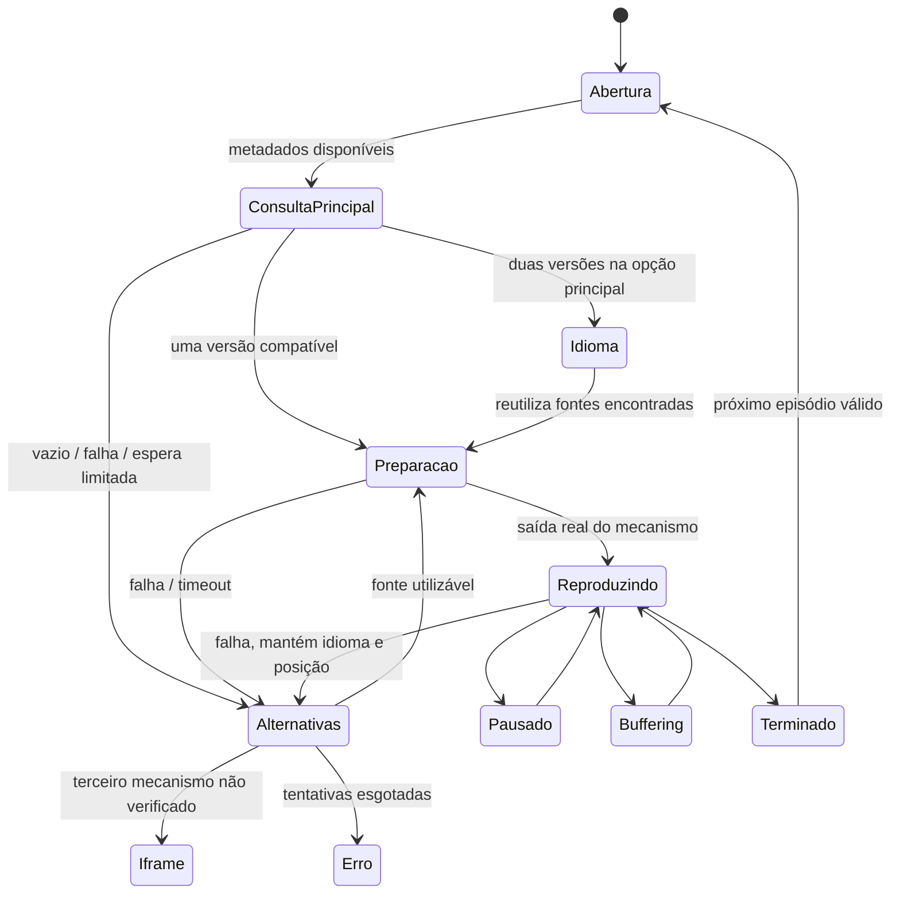

# NOCTA — fluxo do player, servidores, retomada e Busca

> Atualização posterior: [altura, seleção interna, Busca compacta e diagnóstico de Um Trabalho do Inferno](NOCTA_PLAYER_ALTURA_SERVIDORES.md). A seleção não fica mais abaixo do player; este relatório preserva as evidências da etapa anterior.

Atualização de 05/11/2026. Projeto existente: `C:\Users\PC\Desktop\fuzz`. Este incremento sucede `NOCTA_PLAYER_DEFINITIVO.md`; os relatórios anteriores permanecem como registros históricos.

## Resultado implementado

- Player desktop medido em **1280 × 720** numa viewport 1440 × 1080. Android usa a largura inteira e mantém 16:9; fullscreen continua manual.
- Banner reconhecível, N central maior e anel ciano. Pôster é alternativa quando não há backdrop real.
- Busca inicial sem lista de fornecedores; preparação do vídeo também sem essa lista.
- Dublado/legendado reutilizam a resposta encontrada. Uma única versão inicia diretamente. Outra versão descoberta em segundo plano fica no menu, sem reiniciar a sessão.
- Ordem automática: **FenixFlix → Brazuca Play → EmbedMovies**. Zeus está desativado por padrão e preservado para opt-in no código.
- EmbedMovies entra automaticamente como terceiro mecanismo, sem tela de confirmação. Disponibilidade permanece **não confirmada**.
- Opções visíveis usam **Servidor N**, com números estáveis durante a sessão; nomes reais ficam na configuração/diagnóstico.
- Preferência interna de servidor, mecanismo/formato e idioma acompanham o histórico e a retomada, sem persistir URLs de mídia.
- Busca com cabeçalho compacto, filtros temáticos, submissão fechando o teclado e retorno à pesquisa anterior.
- APK debug final compilado e instalado no Samsung SM-S911B.

## Por que a tela de servidores reaparecia

`AutomaticWatch` utilizava a mesma propriedade `loading` para a descoberta e para `preparing`/buffering inicial. `PlayerStage` desenhava `ProviderRows` incondicionalmente em todo carregamento. Assim, depois da escolha do idioma, o vídeo entrava corretamente em preparação, mas a interface reapresentava a lista — isso não era, por si só, uma nova consulta HTTP.

Agora `loadingMode()` distingue `primary`, `fallbacks`, `media` e `none`. `choose()` muda a preferência e usa as fontes já existentes, sem passar desnecessariamente por `searching`. Os testes de ambas as versões verificam que `find()` continua com uma única chamada. A seleção de idioma considera o primeiro fornecedor utilizável; uma resposta antecipada de segundo plano não força uma escolha desnecessária enquanto a opção principal ainda está dentro da vantagem inicial.



Os nomes internos de fase foram preservados para evitar uma migração desnecessária dos contratos. A apresentação é derivada explicitamente desses estados. Atualizar os resultados em segundo plano não muda o `runId` de uma reprodução ativa nem recria seu player.

O Fenix começa primeiro; a Brazuca é consultada após 700 ms em segundo plano. A vantagem inicial do principal é limitada a 2,2 s quando já existe alternativa útil. Cada consulta tem limite de 6,5 s; preparar a sessão iframe tem limite de 3 s. Uma fonte da Brazuca pode iniciar antes dessa preparação terminar. Cancelamento, máximo de duas tentativas automáticas por fornecedor e proteção de 45 s de inicialização/stall continuam ativos.

## Tamanho, banner e rolagem

Foi removido o limite baseado em `72svh` que estreitava o vídeo em janelas baixas/orientação horizontal. A região principal permite 1280 px de vídeo, sem mudar a identidade do site. A seleção completa de fontes fica abaixo do retângulo; não precisa rolar dentro de uma janela de 16:9. A escolha simples de idioma permanece centralizada sobre o banner.

O backdrop não recebe mais opacidade 0,45 somada a várias camadas quase opacas. O gradiente atual mantém a leitura e a imagem identificável. A abertura de um card utiliza o metadado já levado na navegação; um link direto sem metadados mostra primeiro o N e preenche o banner assim que a consulta retorna.

O sincronizador nativo usava **debounce de 40 ms**: cada evento de scroll cancelava a atualização anterior. Isso podia deixar a camada nativa parada durante a rolagem contínua, reposicionando-a depois. A atualização agora acompanha `requestAnimationFrame`, com uma chamada em voo e coalescência da posição mais recente, sem atualizar estado React nem recriar o player. Resize, viewport e recortes continuam sincronizados.

Teste físico: deslocamento de 80 CSS px moveu os bounds nativos de `[3,643][1077,1247]` para `[3,403][1077,1007]`, preservando largura/altura e com **um único load**. A diferença de 240 px corresponde à escala 3 do aparelho. Captura inspecionada em `controlled-scroll.png`. Isso verifica essa sequência, não garante ausência de qualquer problema em todos os aparelhos/orientações.

O plugin Java, tema, overlays transparentes, MKV/HLS e isolamento de leases foram preservados neste incremento. Não houve outro player, Picture-in-Picture automático ou mudança nas proteções do WebView. A orientação oficial recomenda conservar SurfaceView quando atende ao caso; não foi trocada a superfície sem necessidade comprovada. [Media3: tipos de superfície](https://developer.android.com/media/media3/ui/surface).

## Nomes e prioridade

`Candidate.displayName` é atribuído uma vez por identidade da opção na sessão. Outras fontes encontradas depois não renumeram as anteriores. O identificador visível não representa a prioridade interna nem uma promessa de disponibilidade permanente. As etapas de consulta são mostradas como **Consulta 1, 2, 3**, distintas das opções concretas **Servidor 1, 2, 3…**, evitando confundir grupo consultado com arquivo escolhido.

Nome real, `providerId`, `sourceId`, hash de diagnóstico e configuração continuam internos. Qualidade e idioma só aparecem quando informados; Dual/Leg continua uma declaração do fornecedor, sem confirmação automática de legenda ou fala PT-BR. A lista não apresenta nomes como Malfoy/Rubeo, FenixFlix, Brazuca, Zeus ou EmbedMovies no texto normal.

`createSourceProviders()` cria Fenix e Brazuca. O iframe é resolvido pelo fornecedor existente, na terceira posição. `createSourceProviders({enableZeus:true})` permite reativar Zeus explicitamente; sua classe, configuração e testes não foram apagados.

## EmbedMovies: automático, sem inventário inventado

O guia oficial consultado em 05/11/2026 documenta incorporação por iframe, filmes por TMDB/IMDb e séries por TMDB/temporada/episódio. Não documenta uma API de inventário por seleção nem eventos de reprodução. O link público de status apontou para uma página 404. Não se criou endpoint alternativo nem se inspecionou o DOM cross-origin. [Guia oficial](https://embedmovies.org/#guia-rapido), [link de status consultado](https://embedmovies.org/api-status).

`HybridPlaybackProvider` mantém `/filme/{tmdb}` e `/serie/{tmdb}/{temporada}/{episodio}`. A sessão inclui registro de disponibilidade **unknown**, com origem e validade. Seu verificador é separado de falhas de outros servidores: um erro num addon não prova indisponibilidade do iframe.

Se uma verificação futura fornecer `unavailable` ainda válido, o coordenador não o escolhe. Evidência expirada não bloqueia permanentemente o mecanismo. Atualmente, sem inventário, o terceiro iframe é aberto automaticamente como tentativa não verificada, com nota discreta. `onload` só retira o carregamento do documento; não confirma vídeo, áudio, progresso ou conclusão. Erro do documento/timeout e **Problema com o vídeo?** encerram a tentativa; erro interno invisível exige intervenção do usuário ou API documentada futura.

Sandbox, referrer policy, fullscreen e demais permissões existentes foram mantidos. Não foi comprovada reprodução externa do EmbedMovies neste incremento; seleção automática, estado desconhecido, expiração e falha foram cobertos com testes controlados.

## Histórico e limites do cache

O schema `nocta.library.v2` foi estendido com campos opcionais, preservando favoritos, migração v1 e registros anteriores. Cada título/episódio pode conter:

- metadados do título, tipo, IMDb recebido do TMDB, temporada/episódio;
- posição/duração efetivamente medidas, data e conclusão;
- idioma escolhido, fornecedor interno, chave semântica de preferência, mecanismo e formato.

A chave de preferência é um hash de metadados do servidor/formato/qualidade/versão. Não contém URL, query assinada, header ou credencial. Ela identifica uma preferência de servidor, **não garante o mesmo arquivo entre respostas**; várias opções semanticamente iguais podem coincidir. A identificação do título/episódio é independente e precisa coincidir. Dados inválidos são descartados sem eliminar o histórico válido.

Ao retomar, o app consulta novamente os fornecedores, procura uma opção fresca correspondente e passa a posição ao mecanismo existente. Se ela sumiu, tenta outra compatível com o idioma salvo. Não reabre uma URL antiga do armazenamento. Fontes HTML5/nativas recebem a preferência persistida depois de progresso real; iframe pode guardar a abertura não verificada. Callbacks antigos não atualizam a sessão atual.

O checkpoint real anterior é preservado também quando se abre um iframe. Ele fica em `lastKnownProgress`, separado de progresso do iframe; nenhuma barra fictícia é criada. Se depois houver outra fonte com seek, esse checkpoint pode ser utilizado. Não há como descobrir quanto foi assistido dentro de um iframe sem eventos documentados.

| Camada | Implementação / limite |
|---|---|
| Metadados TMDB | cache existente em memória: tendências 2 min, demais consultas 5 min; até 100 chaves; stale de até 30 min em falha |
| Resultados de busca | memória por consulta, 2 min e até 12 buscas; mantém páginas ao voltar |
| Histórico | localStorage, posição/episódio/preferência; não armazena mídia |
| URLs de fontes | somente memória da sessão; após 90 s exigem atualização limitada; não comprovam reprodução |
| Segmentos Media3 | **não habilitados para as fontes externas** |
| Offline integral | **não implementado nem prometido** |

O Media3 oferece `CacheDataSource`, `SimpleCache` e remoção LRU. Uma implementação futura deve exigir permissão explícita por fonte, quota e expiração — por exemplo 128 MiB/24 h, removíveis nas configurações — sem tratar segmentos parciais como filme completo. Não foi adicionada persistência de segmentos de terceiros nem download integral: as respostas atuais não comprovam permissão de armazenamento. [Documentação de cache Media3](https://developer.android.com/media/media3/exoplayer/network-stacks#caching).

## Barbie Butterfly e a Princesa Fairy

O usuário esclareceu o título; a correspondência verificada no TMDB foi:

| Campo | Valor |
|---|---|
| Título PT-BR | Barbie Butterfly e a Princesa Fairy |
| Original | Barbie Mariposa & the Fairy Princess |
| Ano | 2013 |
| Tipo | movie |
| TMDB | 196254 |
| IMDb via external_ids | tt2946582 |

Não foi associado ao outro filme Butterfly nem à Barbie de 2023. A busca em português e a busca pelo título original retornaram a mesma correspondência. Evidência: `.cache/player-fluxo/barbie.json`.

O manifesto efetivamente consultado foi `https://brazuca-play-stremio.vercel.app/manifest.json`: `org.brazucaplay.stremio`, versão 2.1.5, recursos catalog/meta/stream, tipos movie/series/tv e prefixos `bp_`/`tt`. A operação Stremio `stream/movie/tt2946582.json` respondeu 200 com **2 fontes HLS**, uma Dublado e outra Dual/Leg, ambas no domínio já configurado e sem proxyHeaders declarados.

O adaptador real do Nocta retornou **2 candidatas para web e 2 para Android**. Nenhuma foi excluída por formato, gênero, idioma ou qualidade. Não foi necessário adivinhar um `bp_`, mudar o manifesto nem inventar suporte TMDB no complemento. A regressão verifica o IMDb, tipo movie e caminho exatos. Não existe cache negativo persistente de fontes nesse caminho.

**Tentativa física:** a fonte dublada Brazuca foi selecionada pela lista e falhou em mídia com `ERROR_CODE_IO_BAD_HTTP_STATUS`, código 2004, HTTP **404**, categoria network. Não foi um erro de codec ou comprovação de CORS. O fallback encontrou uma fonte Fenix para o mesmo ID, que iniciou com primeiro frame, áudio avançando e posição crescente, inline e sem fullscreen automático. Captura da tela foi inspecionada. O sucesso foi do **Fenix**, não da Brazuca. O idioma falado não foi confirmado por escuta humana; a versão era declarada dublada.

Não é possível provar por que uma tentativa antiga mostrou zero, pois não há seu ID/configuração/resposta registrados. A URL do manifesto instalado no Stremio não foi fornecida para comparação completa. O resultado atual comprova identificação/consulta/normalização corretas e falha HTTP na opção selecionada, não equivalência de todas as configurações nem sucesso da segunda opção Dual/Leg. A disponibilidade do arquivo não é provada por duas linhas na API.

## Busca solicitada durante o trabalho

- Título curto **Buscar**, subtítulo menor, menos espaço antes do input e sem o botão superior redundante.
- `type=search`, `enterKeyHint=search` e blur no submit. No Samsung, `mInputShown` mudou de true para false; o foco saiu do input. O flag interno `mIsInputViewShown` ainda estava true na leitura imediata, mas a captura final mostrou a página sem teclado.
- `ThemedSelect` mantém o select e seus eventos, abrindo diálogo temático em vez da lista nativa variável. Texto branco, seleção/foco ciano, áreas de 48 px, navegação por setas/Home/End e cancelamento.
- Android Voltar fecha o diálogo antes de navegar. Isso foi testado no Samsung, mantendo a URL.
- `MediaCard` leva `returnTo` e metadados na navegação. `BackLink` respeita o histórico e usa essa origem como fallback, em vez de sempre apontar à Home. Hardware Back já respeita o histórico; não foi criada outra rota de Busca.
- Termo, filtros, páginas e scroll usam os mecanismos existentes. Navegador e Samsung retornaram à mesma pesquisa. A restauração de scroll pode deixar o cabeçalho fora da tela, de acordo com a posição anterior; isso é intencional.

## Verificação executada e limitações

| Verificação | Resultado |
|---|---|
| Vitest final | **241 passaram, 1 ignorado**; 30 arquivos passaram, 1 ignorado |
| Teste ignorado | integração HTTP controlada opcional, depende de `NOCTA_STREMIO_INTEGRATION=true`; não contado como executado |
| TypeScript / Vite / Capacitor sync / assembleDebug | passaram |
| Edge desktop/mobile, vídeo controlado | 1280×720; idioma sem outra consulta; nomes ocultos; sem fullscreen automático; filtros, blur e retorno à Busca aprovados |
| Samsung, fluxo normal controlado | HTML5 MP4 e Media3 MP4/HLS com frame/áudio/progresso; rolagem mantém tamanho e uma sessão |
| Samsung, Busca final | diálogo legível; Back fecha filtro; teclado deixa de estar mostrado; retorno restaura a pesquisa |
| Barbie real | Brazuca dublada 404; recuperação pelo Fenix com renderização/áudio/progresso |
| Badger/Rubeo/Arthur/Malfoy | contratos, formatos, headers e isolamento preservados na suíte; não se declara uma nova execução de cada fonte indisponível |
| Próximo episódio | regressões de fim real, limite de 35 s, mudança de temporada e eventos antigos passaram; não repetido em serviço externo neste incremento |

Um roteiro físico adicional que combinava scroll e clique por coordenadas em fullscreen não confirmou a entrada em fullscreen; seu Back retornou à biblioteca e a etapa seguinte não encontrou o menu. Isso **não foi contado como teste nativo de fullscreen aprovado**, nem como erro de codec. O roteiro foi corrigido para não enviar Back quando não registrou `fullscreen-enter`; a reprodução e a rolagem foram verificadas separadamente com sucesso. O controle Media3 existente não foi substituído. Nova confirmação manual de fullscreen/orientação em outras sequências permanece uma limitação desta rodada.

As provas de iframe, desaparecimento/expiração de fonte e reentrada de histórico usam contratos controlados quando o cenário externo não ocorre. Não se afirma funcionamento offline nem disponibilidade permanente. O teste real de reprodução pode registrar o título no histórico como qualquer reprodução normal; favoritos não foram modificados.

## Arquivos alterados

- `src/playback/coordinator.ts`, `providers.ts`, `PlayerStage.tsx`, `AutomaticWatch.tsx`: prioridade, modos de carregamento, idioma, numeração, iframe automático e recuperação.
- `src/playback/NativePlaybackView.tsx`: sincronização da geometria durante scroll, sem remontagem.
- `src/domain/playbackResume.ts`, `src/state/library.tsx`: preferência validada e checkpoint independente do iframe.
- `src/services/playback.ts`, `availability.ts`: disponibilidade do iframe separada de outros servidores.
- `src/components/ThemedSelect.tsx`, `MediaCard.tsx`, `Layout.tsx`, `AndroidLifecycle.tsx`, `src/pages/Search.tsx`, `src/styles.css`: filtros, foco/teclado, retorno e apresentação.
- Testes: `playback-coordinator`, `player-stage`, `automatic-watch`, `native-lifecycle`, `history`, `search-mobile` e demais regressões existentes executadas.
- Roteiros: `scripts/player/flow-ui-check.mjs`, `search-device-check.mjs`, `recovery-check.mjs`, `recovery-live-check.mjs`.
- Este documento e referência no relatório anterior. `dist` e assets públicos Android são saídas do build/sync.

Evidências em `.cache/player-fluxo/`: `browser-ui.json`, `controlled.json`, `samsung-search.json`, `live-brazuca.json`, `barbie.json`, `barbie-adapter.json`, logs e imagens. Respostas de mídia foram reduzidas a identidades, formatos, estados e erros; URLs assinadas/credenciais não foram incluídas neste relatório.

Capturas inspecionadas: `desktop-primary.png`, `mobile-search-filter.png`, `controlled-scroll.png`, `samsung-search-filter.png`, `samsung-search.png` e `live-barbie-brazuca.png`. Os testes controlados usam os clipes autorizados já existentes; não criaram novos vídeos, players ou proxies.

## APK e comandos

APK debug final instalado: `C:\Users\PC\Desktop\fuzz\android\app\build\outputs\apk\debug\app-debug.apk`.

SHA-256 local: `a5736eb92c58922ff89ebf506979059ea95ba03d9c197015f746c346236c4ae9`.

```powershell
Set-Location 'C:\Users\PC\Desktop\fuzz'
npm.cmd test
npm.cmd run dev
```

Build web, sync Capacitor e compilação Android (Node/npm, JDK 21 e SDK Android 35, já disponíveis nesta máquina):

```powershell
$env:VITE_ENABLE_STREMIO_EXPERIMENT='false'
$env:VITE_ENABLE_NATIVE_EXPERIMENT='false'
npm.cmd run android:build
& "$env:LOCALAPPDATA\Android\Sdk\platform-tools\adb.exe" -d install -r 'C:\Users\PC\Desktop\fuzz\android\app\build\outputs\apk\debug\app-debug.apk'
& "$env:LOCALAPPDATA\Android\Sdk\platform-tools\adb.exe" -d shell am start -n app.nocta.prototype/.MainActivity
```

Roteiros reproduzíveis (com Edge instalado para o primeiro; Samsung desbloqueado/USB autorizado para os demais):

```powershell
node scripts/player/flow-ui-check.mjs
$env:NOCTA_CHECK_DIRECTORY='.cache/player-fluxo'
node scripts/player/recovery-check.mjs --scroll
node scripts/player/search-device-check.mjs
node scripts/player/recovery-live-check.mjs --barbie
```

O último escolhe a Brazuca pela opção interna no menu e registra o fornecedor **que efetivamente reproduziu**, inclusive se houve fallback. Os roteiros controlam o aparelho durante a execução; não tocar simultaneamente. Não usam emulador. Não foram implementados anúncios, assinaturas, publicação, reformulação da Home ou mudanças nas consultas dos trilhos.
